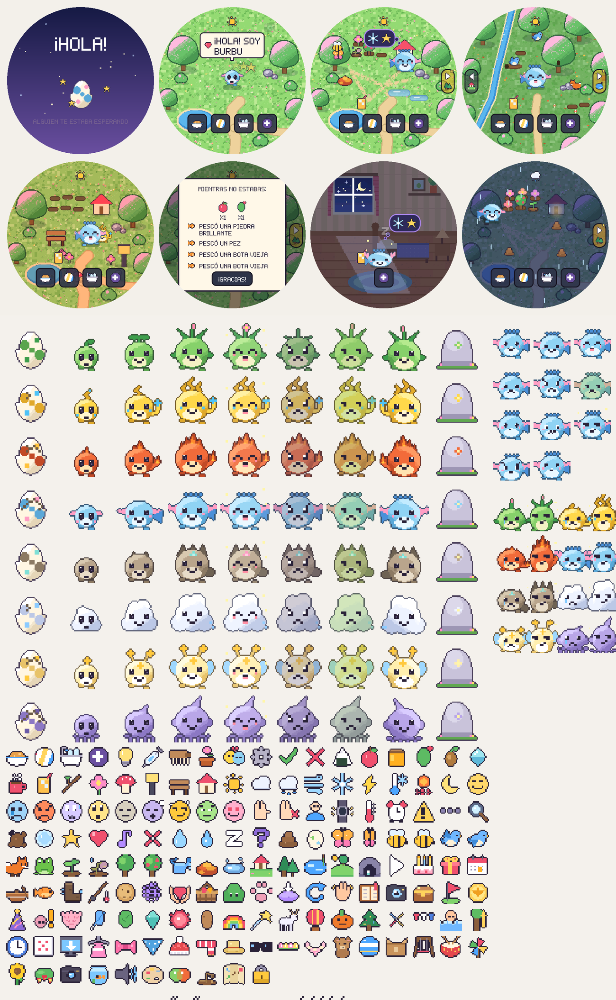
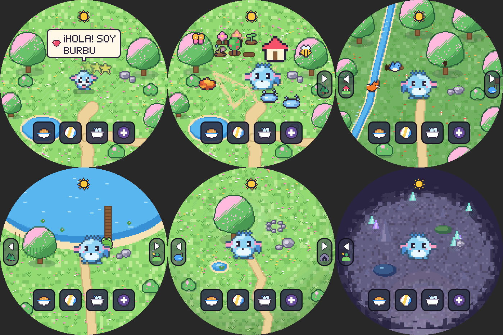
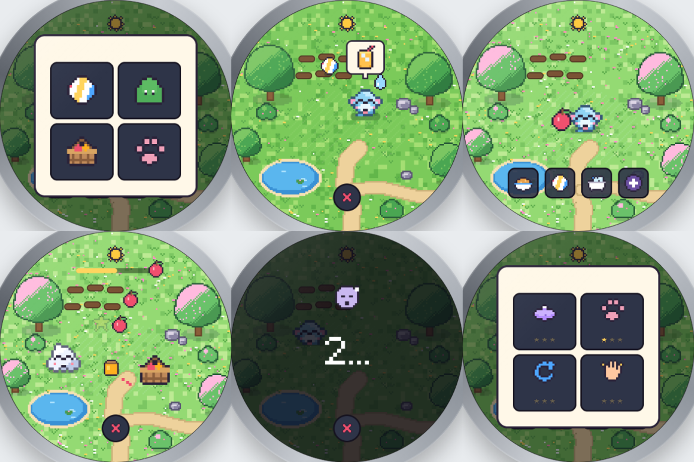
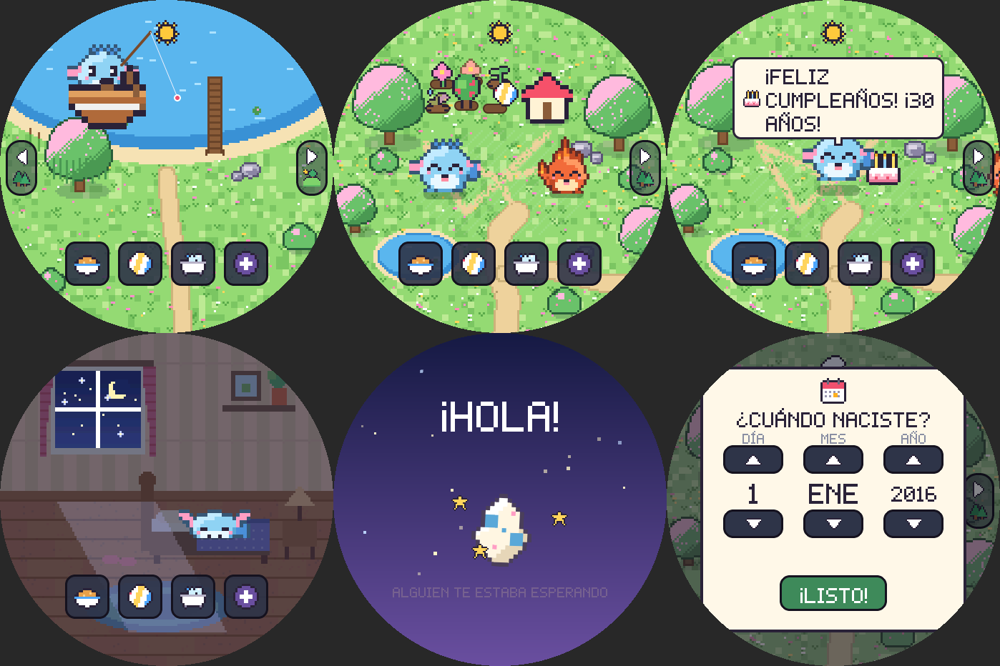
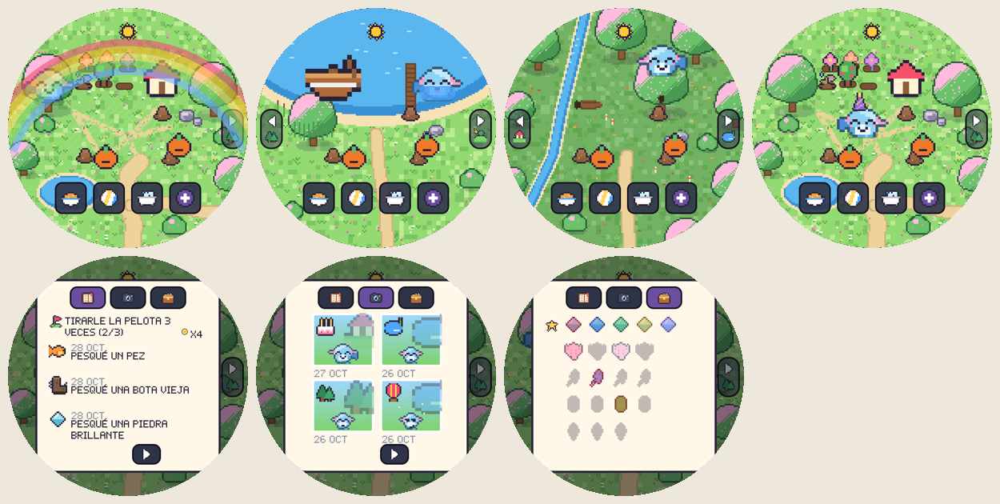
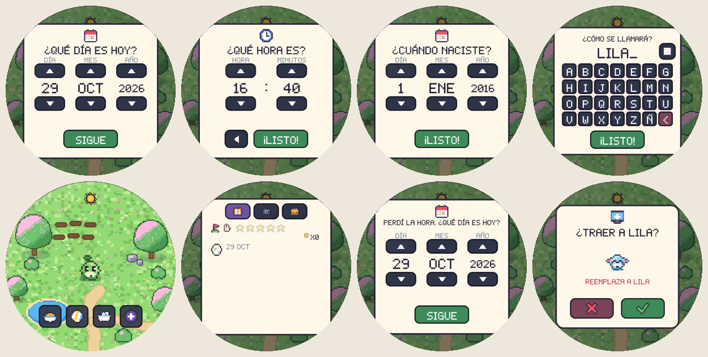
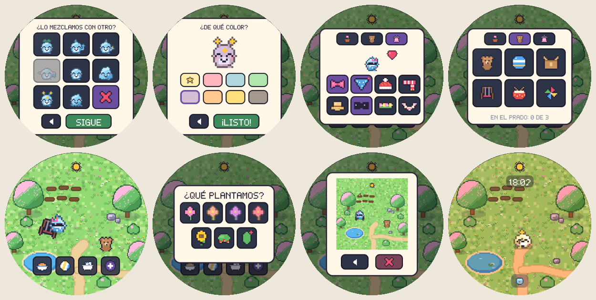

# Mascota virtual de bolsillo — firmware, simulador y arte

Proyecto para la **Waveshare ESP32‑S3‑Touch‑AMOLED‑1.75** (o la 1.75‑B con caja): ESP32‑S3R8,
32 MB de flash, 8 MB de PSRAM, AMOLED redonda 466×466 táctil, parlante y micrófonos (ES8311/ES7210),
acelerómetro QMI8658, RTC PCF85063 y chip de batería AXP2101.















```
mascota/
├── core/                 Motor portable en C99 (el mismo en el orbe y en el PC)
│   ├── pet.h / pet.c     Huevo y crecimiento; 8 necesidades -> 10 emociones mezcladas con
│   │                     su causa; personalidad que cambia; memoria afectiva con olvido;
│   │                     autonomía (qué hace sola y dónde); hallazgos y decoración;
│   │                     estaciones y clima; mensajes del día; amigos cercanos; modo niño;
│   │                     el mundo: 5 zonas, animales, jardín, charcos, hojas y caminos;
│   │                     gestos, su amigo del barrio, pesca, tu cumpleaños; vínculo, nadar
│   │                     y trepar, diario, álbum, colecciones, tesoros, sorpresas, metas,
│   │                     su cumpleaños y fechas especiales; catálogo de sonidos
│   ├── objetos.h / .c    los 150 objetos mágicos de la Bolsa (efecto, gesto, dónde aparecen)
│   ├── sfx.h / sfx.c     Sonidos sintetizados (sin archivos de audio), la canción de cumpleaños y el ambiente
│   └── foto.h / foto.c   Fotos de la pantalla comprimidas en QOI (sin pérdida)
├── firmware/             Proyecto ESP-IDF para el orbe
│   └── main/
│       ├── art.c         Arte en pixel art generado por código: 8 criaturas elementales
│       │                 en 3 etapas con lenguaje corporal (orejas, cola, postura, 11 caras),
│       │                 huevo, 5 zonas en 4 estaciones, animales, plantas, íconos y fuente;
│       │                 pixeles de 2 × 2 en pantalla (criaturas 30 × 30, íconos 24 × 24)
│       ├── ui.c          La interfaz: edad, nombre, huevo, pradera, clima, pensamientos,
│       │                 caricias por zona, paneles (comer, estado, rincón, amigos, ajustes)
│       ├── radio.c       Bluetooth LE (NimBLE): emitir y escuchar balizas de amigos
│       ├── services.c    Pantalla (BSP), RTC, batería, acelerómetro, parlante, guardado, botón
│       └── main.c        Bucle principal
├── sim/
│   ├── main.c            Simulador de texto con tiempo acelerado
│   ├── web/              Simulador en el navegador (motor + interfaz compilados a WebAssembly)
│   ├── windows/          Instalador del simulador como app de Windows
│   └── preview/          Vistas previas en imagen de la interfaz y del arte
└── tests/                Pruebas del motor
```

## 1. El juego

La idea central: **su estado se lee mirándola**, sin números en la pantalla (tampoco la hora).

- **Inicio**: una pequeña animación de **bienvenida** (un huevo que baja del cielo estrellado, con su
  melodía) y luego, en orden: la **fecha y la hora de hoy**, tu **fecha de nacimiento** y el **nombre**
  de la mascota (con un dado que sugiere nombres al azar). Antes del nombre eliges **cómo será**: su especie
  (o sorpresa), si la **mezclas** con otra y sus **colores**. Todo con flechas; dejar apretada una flecha
  avanza rápido. Con tu fecha calcula tu edad, elige el modo y sabe cuándo es **tu cumpleaños**.
- **Tres modos según la edad** (cambia sola de modo en tu cumpleaños):
  - **Infante (hasta 6 años)**: sin textos en ninguna parte. Los globos, el diario, las metas y el
    resumen al volver son solo dibujos; los minijuegos son más lentos y fáciles; nunca se enferma.
  - **Niño (7 a 11)**: con textos cortos; sin castigos (no hay forma gruñona, se enferma menos y nunca
    queda en mal estado, el zorro solo se asoma); juegos algo más fáciles.
  - **Adulto (12 o más)**: textos, matices, estadísticas y algo de desafío.
  - **El modo se puede elegir a mano** (Ajustes → Más → Modo de juego), con una explicación corta de cada
    uno. Pasar a uno con menos protección (de niño a adulto) pide mantener apretado.
- **Si se queda sin batería**: no se pierde nada. La partida se guarda en la memoria flash cada 5
  minutos, después de cada cosa que haces y apenas la batería llega a 4 %. Se guarda en **dos copias**
  que se turnan, cada una con su comprobación: si una se daña (un corte justo al guardar), queda la
  otra. Si el orbe perdió la hora, en vez de inventarla la **pregunta** ("Perdí la hora. ¿Qué día es
  hoy?") y mientras tanto todo queda en pausa; no acepta una hora anterior a la última vez que se usó.
- **Respaldo** (Ajustes → respaldo): la mascota completa (personaje, recuerdos, diario, álbum,
  colecciones, lo aprendido) se puede guardar en el computador por el cable USB con el editor y
  traerla a otro orbe si este falla; traerla siempre se confirma en la pantalla. El mismo archivo
  `.mascota` sirve en el simulador. Detalles para el editor en `docs/editor.md`.
- **Celebraciones configurables**: las fechas especiales son una tabla de hasta 16 celebraciones
  guardada en el orbe. El editor puede cambiar sus fechas (por ejemplo las Fiestas Patrias) y agregar
  otras (día fijo, "el 2º domingo de mayo" o el primer día de primavera), con su nombre y su saludo,
  pero siempre usando una de las seis decoraciones que existen: calabazas, arbolito, fuegos
  artificiales, corazones, flores o banderines (`docs/celebraciones.json`).
- **Necesidades** (de fondo, no se muestran salvo en el panel del adulto): hambre, energía, higiene,
  diversión, cariño, salud, **curiosidad** (baja con la rutina; sube explorando y con cosas nuevas) y
  **seguridad** (baja con truenos, sustos y extraños).
- **Emociones mezcladas con causa**: alegría, tristeza, enojo, miedo, curiosidad, aburrimiento,
  cansancio, orgullo, celos y cariño. Pueden convivir ("feliz, pero con sueño") y cada una tiene su
  motivo: triste *porque hoy no jugaron* o *porque llueve y prefiere el sol*; con miedo *porque hay
  truenos*; celosa *porque mimaste a la visita*. El motivo aparece en una **nube de pensamiento** con
  dos dibujos (qué siente y por qué). El adulto lo lee en palabras en **Más**.
- **Lenguaje corporal**: cara (11 expresiones), orejas/crestas/hojas/antenas alertas o caídas, cola que
  se mueve o cae, postura erguida, encogida o echada, y forma de caminar (saltitos contenta,
  arrastrando los pies con sueño, temblando con miedo, pisando fuerte enojada).
- **Personalidad propia que cambia**: glotona, juguetona, cariñosa, tímida/valiente, pulcra, curiosa y
  traviesa. Nace con una mezcla y se mueve según cómo la tratas (si juegas mucho, se vuelve más
  juguetona; si la consuelas cuando tiene miedo, más valiente).
- **Memoria afectiva con olvido**: recuerda dónde se asustó (y lo evita unos días), dónde la acaricias
  (y te espera ahí a la hora de siempre), qué comida odia, qué clima le gusta y en qué parte del cuerpo
  le gusta que la toquen. Todo se desvanece si no se refuerza.
- **Vínculo**: al principio desconfía (a veces se aparta si la tocas); con cuidados te tiene confianza
  y te **trae lo que encuentra** (a veces una ramita).
- **A veces dice que no**: si está enojada, cansada o es traviesa puede ignorar una orden, pero nunca
  dos veces seguidas la misma.
- **Autonomía**: sola pasea, olfatea, cava, explora, duerme siesta, busca sombra en verano, juega en la
  nieve si le gusta, mira la lluvia, se refugia de la tormenta y te espera donde sueles acariciarla.
  Se mueve por seis lugares del prado: claro, estanque, árbol, rocas, sendero y casita.
- **Llamarla**: toca dos veces un lugar del prado y va hacia ahí contenta, se queda un rato y te mira.
  Si todavía desconfía duda (da unos pasos y se detiene), si duerme no viene, y una traviesa o enojada
  a veces se hace la desentendida.
- **Gestos** (la pantalla es chica, así que no se apunta a partes del cuerpo): **un toque** es una
  palmadita, **deslizar el dedo** sobre ella es una caricia (deja corazoncitos por donde pasa),
  **mantener el dedo** es un abrazo (se aplasta contenta) y **muchos toques seguidos** la marean (ojos
  en espiral y se enoja; a algunas traviesas les dan cosquillas). Cada una tiene sus gustos, que se
  descubren con el tiempo; a las tímidas los abrazos les cuestan al principio. Muchos toques también
  la despiertan (de mal humor). Puedes acariciar a una visita... y ponerla celosa.
- **Jugar** (interacción directa): el botón Jugar abre un menú con cuatro opciones.
  - **Pelota**: aparece la pelota frente a ti; **deslízala con el dedo** para tirarla. Vuela, rebota en
    el suelo y en los bordes, y rueda si inclinas el orbe. Ella corre, la atrapa (a veces en el aire)
    y te la trae. Cansada va pero se echa al lado; una traviesa a veces se escapa con ella. Si no la
    tiras en un rato, el juego termina solo (o con la ✕).
  - **Escondidas**: tú "cuentas" (pantalla oscura, 1, 2, 3) mientras ella se esconde detrás del árbol,
    las rocas o la casita. Cada tanto se mueven unas hojitas donde está. Toca dónde crees que está:
    tienes dos intentos; si no, sale ella muerta de risa.
  - **Atrapar frutas**: 20 segundos para atrapar frutas que caen moviendo una canasta con el dedo (o
    inclinando el orbe). Con 8 o más, te ganas una fruta de premio.
  - **Trucos**: **hacerse la dormida** (se tira de costado con los ojos cerrados y unas Zzz, y de un salto:
    ¡ta-dá!), **voltereta** (se agacha y da un salto alto con un giro completo en el aire), **dar una
    vuelta** (se da vuelta de un lado al otro dos veces, como trompo) y **saludar** (salta mirando a un lado
    y al otro, con un "¡hola!" y un corazón). Al principio casi nunca le sale;
    practicando lo aprende (tres estrellitas muestran cuánto sabe), avisa cuando aprendió uno y,
    contenta, a veces lo hace sola. Si practican demasiado seguido se cansa, y lo que no se practica se
    olvida de a poco.
- **Darle de comer arrastrando**: al elegir la comida, aparece abajo; **arrástrala hasta su boca**. Ella
  la mira, abre la boca y, si tiene hambre, te sigue con pasitos. Si la dejas en el suelo, va a
  buscarla; si no tiene hambre, la guarda para después.
- **Inclinar y sacudir el orbe**: al inclinarlo se resbala hacia el lado más bajo ("¡wiii!"; a las
  tímidas las asusta un poco), la pelota rueda y la canasta se mueve. Sacudirlo en el prado o el bosque
  hace caer fruta del árbol (hasta 2 por día).
- **Amigos del barrio** (fase 3): amiguitos que viven en el mismo orbe (no vienen por Bluetooth). Cada
  visita es **un amigo distinto, al azar** (entre 20 nombres, de otra especie y con sus propios colores), cada
  medio día o un día, de día y cuando tú andas cerca. Más adelante cada uno podría tener su
  personalidad y sus recuerdos; el lugar para eso ya está guardado. Juegan a la pelota,
  comen juntos (comparten tu fruta o él trae galletas), se persiguen, conversan, duermen una siesta y
  a veces le trae un regalo (semillas, piedras, fruta o miel). La amistad con el barrio crece con cada
  visita; en **Amigos** la ves con sus corazones y puedes **llamar** a alguien para que venga. Si lo mimas a él, ella
  puede ponerse celosa.
- **Pesca en el lago**: en el lago hay un **bote**. Tócalo y sale a pescar (también lo hace sola): rema
  hasta el medio, tira la caña y espera la boya. Puede sacar un pez (si tiene hambre se lo come, si no
  lo devuelve al agua; en modo niño siempre lo devuelve), una bota vieja (le da risa), una piedra
  brillante o nada. En invierno el lago está helado: se pesca en un hoyo en el hielo (v93).
- **Su casita por dentro**: si le pusiste la casita, al dormir camina hasta ella, entra y se ve el
  cuarto: su camita, una ventana que muestra el cielo (de noche, estrellas y luna, y un rayo de luna en
  el piso), la alfombra y su lámpara. Al despertar sale por la puerta.
- **Mientras duerme**: le salen "Z" y cada tanto aparece una nube oscura con lo que **sueña**, sacado de
  lo que vivió (su amigo del barrio, su comida favorita, la pelota si jugaron hoy, las mariposas, los
  peces del lago, su zona preferida, tus mimos...); si tuvo un susto, a veces un mal sueño. Dormida no
  se le puede dar comida, jugar ni bañar, así que esos botones se esconden y solo queda "Más" (la luz).
- **Tu cumpleaños**: ese día, en cuanto despierta, te saluda con un deseo tierno (sin decir tu edad), confeti y la **canción de
  cumpleaños** (la melodía tradicional, de dominio público); y hay un **pastel** en el mundo todo el día:
  tócalo para cantar otra vez. Al cumplir 12 años pasa sola a modo adulto (salvo que el modo se haya elegido a mano).
- **Sin muerte**: si la dejas sola días, se pone triste y te extraña, pero nunca queda en peligro. Al
  volver te recibe feliz y te muestra lo que encontró mientras no estabas.
- **Depende de ti**: sola se entretiene (juega, explora, persigue mariposas, se calma), pero eso solo la
  deja más o menos bien: la diversión y el cariño no pasan de la mitad sin ti (un poco más en modo niño) y
  la comida y el baño son solo tuyos. Si tiene hambre, está sucia o le falta cariño no puede estar feliz
  del todo: una mariposa la distrae un ratito, pero se le nota triste y dice por qué ("porque tengo
  hambre", "porque hace rato que no me haces cariño"). Lo que siente en palabras siempre tiene sentido:
  no junta "estoy triste" con "pero me siento feliz" sin un motivo para cada cosa; si te extrañó y
  volviste, lo dice así ("Te extrañé mucho, ¡pero ya estás aquí!").
- **Perfiles** (Ajustes → Perfiles): el dispositivo se comparte; cada persona tiene su mascota, que se
  elige por su cara y su nombre, sin claves. Caben 3 descansando además de la activa; al empezar una
  nueva, la de ahora queda guardada. Cada perfil elige **qué pasa cuando no está**: *descansa* (para ella
  no pasa el tiempo; así vienen los perfiles nuevos) o *sigue viviendo* (al volver se pone al día como si
  te hubieras ido esos días, nunca en peligro, y te cuenta lo que pasó). Sus alarmas, hora de dormir,
  diario, álbum, colecciones y modo son suyos; el jardín, las decoraciones, el baúl, las semillas, el
  clima, el hemisferio, el volumen y el brillo son de la casa. Cada perfil se guarda en su propio espacio,
  con su propia comprobación.
  - Para hacer lugar se puede **despedir** a una (botón *De viaje*): **se va de viaje a explorar el
    mundo mágico** y lo ves en una animación al azar — volando sobre una pluma gigante bajo la aurora, en un
    barquito de hoja con vela de pétalo por un lago de estrellas, en el tren de luciérnagas sobre un
    puente de arcoíris o colgada de un diente de león gigante al amanecer —, saludándote, con su sonido
    (viento mágico, campanas, silbato de cristal o un soplido) y un "¡Buen viaje!". No vuelve: antes conviene guardarla con el editor (Respaldos).
  - **Lo irreversible pide mantener apretado**: despedir, borrar una foto y pisar a la de ahora con un
    respaldo. Los modos infante y niño no ven esas opciones: el perfil adulto hace de administrador.
- **Se le ve la suciedad**: cuando aparece el botón de la bañera, a ella se le ven salpicaduras de barro
  redondas (con borde oscuro y un brillito, para que no parezcan pelo) en la pancita y los costados de abajo,
  y las patitas embarradas (la cara siempre limpia); más sucia, más barro; muy sucia, se ve opaca y
  dos moscas chiquitas le dan vueltas a la cabeza. Las cacas del prado son aparte: se recogen tocándolas.
- **Los menús**: abajo solo hay tres botones, **comer, jugar y más**. Cuando está sucia aparece un cuarto,
  **bañar**: al tocarlo sale una esponja que se frota sobre ella hasta que queda limpia (con burbujas).
  - **Más** es un vidrio redondo, del tamaño de la pantalla, con tres pestañas redondas arriba que siguen
    la curva del orbe: **ella** (cómo está, sus necesidades, el vínculo en corazones sin números, la luz,
    el **libro mágico**, la **bolsa**, el mapa y los amigos; la jeringa aparece solo cuando está enferma; cada fila
    tiene su lugar fijo contado desde abajo, así nada se encima), **recuerdos** (una lista: diario, fotos, cámara,
    tesoros y su rincón, cada uno con una línea que dice qué guarda) y **ajustes**. El libro y la bolsa abren
    directo, cada uno solo con lo suyo; el diario, las fotos, la cámara y los tesoros también, con su título y
    una flecha para volver. Los **tesoros** son una lista por colección: cada uno con su nombre (o "sin
    encontrar"); al tocarlo se lee su historia, o dónde buscarlo.
    Arriba siempre dice cómo se siente. Ya no hay botón de cepillo: una caricia larga y suave la peina.
  - **Botones** en forma de píldora, y los de un solo ícono, redondos: combinan con la pantalla.
  - **Sonido**: el volumen y el sonido de fondo, los dos con su barra de 0 a 100. Son ajustes del orbe
    (de la casa), no de cada mascota.
  - **Todos los paneles** se ven sobre ese vidrio: el bosque de ese momento, empañado. Se calcula una sola
    vez al abrirlo (es una imagen opaca), así que no cuesta nada mientras está abierto.
  - **Para salir**: una X redonda abajo, siempre en el mismo lugar, en todos los paneles (menos en los que
    hay que completar, como la fecha o el nombre). Lo largo que no cabe se desliza con el dedo.
  - **Accesos rápidos**: deslizando el dedo hacia abajo desde el borde de arriba salen el brillo, el
    volumen, el modo pecera y las alarmas.
- **El estilo del mundo**: verdes profundos, más tonos en cada copa, sombras que pesan, pinos en los bordes
  (también en el bosque, el lago y la colina; en otoño los pinos siguen verdes y en invierno se nevan),
  pasto con matitas y manchones suaves, y un claro al centro del prado.
  **La isla del lago** (zona nueva, la sexta): se ve a lo lejos desde el lago cuando ella ya es cría y confía
  mucho en ti; un día, pescando o mirando el agua, dice "¡veo una isla a lo lejos!". Tiene playa con conchas,
  un **árbol muy viejo** con frutos de luz, un **círculo de piedras antiguas** con runas que brillan apenas, un
  **faro** chiquito que de noche se enciende y un muelle. **El bote sirve para dos cosas**: si todavía no
  conoce la isla, tocarlo es salir a pescar, como siempre; cuando ya la vio, tocarlo pregunta **pescar o ir a
  la isla**. En la isla, el bote queda amarrado al muelle: tocarlo es volver. El mapa también lleva (con el
  lago helado en invierno no hay bote). **El cruce**: se ve el lago de lado, la orilla atrás y la isla
  adelante; arriba, un caminito del lago a la isla con un botecito que avanza (sin carteles: no se parece al
  viaje de despedida). El bote tiene una velita y, si **le soplas al orbe de verdad** (el micrófono; en el
  simulador, el botón Soplar o tocar la pantalla), la vela se llena de viento y va más rápido; abajo, una pista
  corta "sopla para llenar la vela" que se va cuando ya soplaste; a mitad de camino salta un pez. A los más chicos el viento les ayuda solo. A la
  isla **nunca va sola**: es una aventura contigo (y ahí no dice que no); si la dejas mucho rato allá, o llega
  una tormenta, vuelve sola al lago en el bote. Allá encuentra más conchas y cosas de la orilla, y **una vez
  al día llega una botella con un mensaje** (uno de los mensajes que se responden). De día se oye el mar
  (olas que llegan y se retiran, y una gaviota). Para su linaje cuenta como agua de día y como cielo de noche
  (el faro y las estrellas). No cambia el formato de las partidas guardadas: los gustos por zona siguen siendo
  cinco y el de la isla se calcula del lago y la colina.
  **El paseo por el firmamento**: cuando pasa la ballena de nubes (una sorpresa rara; Astro de adulta la
  puede llamar), si la tocas baja y ella se sube. Unos 35 segundos por el cielo: suben entre nubes y pasan
  un planeta con anillos, la luna, un cometa y un planetita rojo, con la Vía Láctea de fondo. Las estrellas
  que titilan se tocan (abajo se juntan puntitos dorados, sin números); con cinco o más trae **polvo de
  estrellas** (el Talco de estrellas) a la Bolsa. Un paseo al día; queda en el diario y en el álbum.
  **El rito de la Guardiana**: la fase de la luna es la de verdad (se calcula de la fecha). Con el **Corazón
  del Mundo**, ya adulta, una noche de **luna llena** en la isla, se saca al prado y se mantiene el dedo
  encima: ella lo lleva a la piedra del centro del círculo, sube una columna de luz, la isla brilla y queda
  como **Guardiana del Mundo** para siempre: lleva una **capa blanca élfica** con ribete dorado (cae por
  detrás, sin taparle la cara), **nunca está sucia** (el rito la deja reluciente y la magia del bosque la
  mantiene limpia: sin barro ni cacas), tres lucecitas doradas le dan vueltas, el Corazón late en la
  piedra con las runas encendidas, encuentra un poco más de cosas mágicas y en cada luna llena el bosque le
  manda luciérnagas. La ficha del Corazón dice cuántas noches faltan para la próxima luna llena. En la
  isla, de noche, duerme bajo el árbol viejo (el Corazón la despierta para el rito). En la isla nunca hay
  cacas.
  **La caja de música**: al usarla suena una melodía propia de caja de música (16 notas a medio segundo) y
  ella baila: gira, salta en cada nota y mueve la cola. Si tocas la pantalla al ritmo, salen corazones; si lo
  sigues bien, "¡bailamos juntos!" y queda en el diario.
  **Se adapta a ti**: si llegas a tu hora de siempre (a darle de comer, a jugar o a hacerle cariño), te
  recibe con "¡sabía que vendrías a esta hora!". Si cinco mañanas seguidas lo primero es saludarla, ya tienen
  sus **buenos días**; si cinco noches seguidas apagas la luz, sus **buenas noches** (con canción de cuna).
  La **hora de dormir** puede ser fija o **aprender tus horarios**: se corre de a poco hacia cuando de verdad
  apagas la luz y la saludas en la mañana. A veces, si estás con ella, se acuerda de algo que vivieron hace
  días: "¿te acuerdas? el 28 oct: ...". Cada lunes el diario tiene una página con **su semana** (cuánto
  jugaron, los mimos y las cosas mágicas que encontró).
  **La familia**: ya adulta, muy querida y con algunas semanas de vida, a veces **deja un huevo** (uno por
  mes, hasta tres). **Al ponerlo, en modo adulto, te ofrece ir a explorar el mundo**: si dices que sí (manteniendo), se despide
  (queda en sus viajes y te escribe) y el huevo empieza a ser la mascota; si dices que todavía no, **lo guarda con mimo en un
  nidito junto a su casita** hasta que lo toques: entonces te pregunta con palabras lindas si quieres que eclosione, y pasa a ser la mascota
  activa mientras ella se queda en perfiles (la traes cuando quieras). El hijo nace con **la forma que tomó ella y
  su color**, la mitad de su manera de ser, sus gustos por lugar a medias y **lo que ella sabía del libro
  mágico** (no sus cosas); en "Ella" dice de qué familia es. Si no hay lugar, el huevo espera.
  **La despedida natural** (Ajustes → Más; solo el adulto la ve y viene apagada): ya grande, a veces siente
  ganas de explorar el mundo y **te pregunta**; "todavía no" y se queda feliz (quizás pregunta en un mes);
  "sí" (manteniendo) y se va de viaje, y queda un huevo nuevo.
  **Perfiles**: otra mascota del orbe puede **venir de visita** (botón de amigos en Perfiles): juegan como
  con un amigo de otro orbe y quedan como amigas. Las **alarmas** tienen un botón para que **suenen
  siempre**, aunque esté activa otra mascota. Cada mascota guarda **sus fotos** de la cámara (hasta 24; al
  pasarse se borra la más vieja de ella); las de antes se siguen viendo.
  **La pantalla se endereza sola** (Ajustes → Pantalla): si giras el orbe un momento (1,2 s), la imagen y el
  táctil giran de a 90° (derecho, de lado a cada lado, al revés); la inclinación también. A probar en la placa:
  si se da vuelta al revés, se cambia `BOARD_IMU_DERECHO_Y` en `board.h`; si de lado queda al revés,
  `BOARD_IMU_DERECHO_X`; la imagen se gira en el propio panel (MADCTL) y el táctil con ella (`bsp_display_orient`); no probado en la placa. En el simulador no gira.
  **La cueva** también: piso de piedra con manchones suaves, paredes de rocas redondas con luz donde miran
  hacia adentro, estalactitas y estalagmitas con su cara iluminada, racimos de cristales (turquesa, violeta y
  rosa) que alumbran el suelo, hongos que brillan solos, una poza honda que refleja los cristales, un colchón
  de musgo y la luz cálida que entra por la boca, a la izquierda (por donde llega y se va). **La casita por dentro**: paredes de troncos, piso de tablas
  con veta, una ventana con marco de madera, cortinas con pliegues y una maceta, la luz de la ventana en el
  piso, una repisa con libros y un frasco que brilla, una cama con edredón de retazos, una lámpara con luz
  cálida y una alfombra tejida. **Los íconos** (todos, también los 150 objetos) tienen el mismo acabado: el
  contorno toma el color de lo que encierra (más oscuro, no negro) y cada parte tiene luz arriba a la
  izquierda y sombra abajo a la derecha, tramadas.
- **La Bolsa y los 150 objetos mágicos** (botón **+** → bolsa): explorando, pescando o paseando contigo
  encuentra, muy de vez en cuando (unos dos al día, nunca dos seguidos en menos de dos horas), cosas
  mágicas de cinco familias: **tesoros de la tierra, flora mística, restos de animales y espíritus,
  objetos perdidos y antigüedades, y artefactos místicos** (30 de cada una, `core/objetos.c`). Sin
  tienda ni monedas: aparecen según dónde está (la cueva tiene cristales, el lago escamas y botas
  viejas), la hora (algunos solo de noche) y la suerte. Si hay confianza **te lo trae en la boca**, te lo
  muestra y **vuela al botón +** (que queda con una estrellita hasta que abras la Bolsa).
  - **Cada objeto hace algo** con uno de unos pocos efectos que se reusan: comer (con copos, humo,
    arcoíris o chispas), calmar una pena, dar energía o sueño, cariño, curar, **ponérselo en la cabeza**
    un rato, **decorar el prado** (hasta cuatro; la bota vieja frotada se vuelve la casita de las hadas),
    regar o hacer crecer el jardín, **magia en el cielo** (aurora, eclipse, chispas, estrellas fugaces,
    fuegos, purpurina, luciérnagas o constelaciones), un **acompañante que sigue tu dedo** (fuego fatuo,
    luciérnaga, espora o una sombra con ojitos), un día con más hallazgos, buena pesca, sin zorro ni
    abejas, o cambiar el clima.
  - **Lo que se come, se bebe, se esparce o se planta se gasta**; las piedras, llaves, libros y amuletos
    no: funcionan una vez al día y descansan hasta mañana (se ven apagados).
  - **Se usan en el prado**: lo sacas de la bolsa y queda flotando en el pasto, cerca de ella. En adulto
    haces su gesto sobre él (tocar, **frotar**, **mantener**, **deslizar** o **soplarle al orbe**); ella va,
    lo toca y hace su magia. En niño (botón **dárselo**) y en infante (tocarlo en la bolsa) ella va sola. Si
    no lo usas en un minuto, vuelve a la bolsa sin gastarse.
  - **Lo que hace cada uno es un misterio** hasta que lo usas una vez: al principio solo dice cómo
    descubrirlo ("Geoda olvidada. Mantén el dedo encima para descubrir qué hace"); después aparece su
    leyenda. En modo niño, en vez del dibujo de lo que hace, hay un signo de pregunta.
  - **Los textos largos se deslizan con el dedo** (la leyenda, el mensaje del día, el resumen al volver), con
    una barrita y una flechita mientras quede más por leer.
  - **Ofrenda al bosque** (en vez de tirarlo): ella lleva el objeto en la boca hasta el árbol hueco del
    prado y lo deja ahí. Al día siguiente el bosque lo agradece con un día de sol y, esa noche, luciérnagas
    por todas partes (una bendición a la vez).
  - **Encontrarlos es fácil**: la bolsa y el libro mágico son una lista que se desliza con el dedo, sin
    páginas, con lo último que trajo arriba (con una estrellita). Arriba hay seis botones redondos: todo, o
    una sola familia (tierra, flora, espíritus, antigüedades y artefactos). En adulto cada fila tiene el
    dibujo y el nombre; en niño e infante, dibujos grandes. Puntitos dicen cuántos tiene, una lunita que
    descansa hasta mañana, una casita que decora el prado.
  - **El libro mágico**: solo lo que ya encontró; se va llenando a medida que aparecen más. El 150, el **Corazón
    del Mundo**, no sale al azar: llega solo cuando ya conoce todos los demás.
- **Regalos al volver**: si te fuiste unas horas, a veces te espera con algo de afuera (uno al día como
  mucho): una **piña** con semillas, una **hoja gigante** que se pone de sombrero, **el palo perfecto**
  para que se lo tires, una **pluma** que le da estornudos, una **semilla con alas** que planta y será un
  árbol, una **piedra del lago** para su colección, o **botas con barro** que dejan huellitas hasta que la bañas.
- **Niebla de la mañana**: algunos días amanece con niebla; se va sola, o la despejas **soplándole al
  orbe** (el micrófono) o **barriéndola con el dedo**. Soplar también apaga las velas del pastel y usa los
  objetos que se soplan, como el diente de león gigante.
- **Hongos luminosos** (Jugar → hongos): un Simón dice con cuatro hongos de colores que se encienden en
  orden; ella los repite contigo.
- **Ajustes** es una cuadrícula de seis íconos grandes que abren pantallas cortas (nada que desplazar
  en la pantalla redonda), con la batería dibujada arriba (sin números):
  - **Sonido**: el volumen (de silencio a máximo; al soltar la barra suena un pío de prueba) y el sonido
    de fondo (de 0 a 100, ajuste del orbe), una barra bajo la otra.
  - **Pantalla**: el brillo (cambia en vivo mientras arrastras, con un mínimo para no quedar en negro;
    bajarlo es lo que más batería ahorra en AMOLED), cuándo se apaga sola (10 s, 20 s, 30 s o 1 min) y el
    modo pecera. La pecera y la noche usan una fracción del brillo elegido.
  - **Hora**: fecha y hora, **hora de dormir**, **alarmas** y **temporizador** (de 1 a 180 minutos, con
    atajos de 1, 5, 10 y 30; suena con su pantalla y su mascota, aunque esté en silencio).
  - **Perfiles** (por ahora, Mis mascotas), **Respaldo** y **Estaciones** (hemisferio sur o norte).
  Volumen, brillo y apagado son del dispositivo: no van en cada mascota ni en el respaldo.
- **Hora de dormir** (opcional, viene apagada): a qué hora te acuestas y te levantas (de a 15 minutos). A
  la hora de acostarse aparece "¡Hora de dormir!" con una canción de cuna y ella bostezando; después la
  pantalla pasa a modo noche, se callan los sonidos (menos las alarmas) y ella se acuesta: en su casita si
  la tienes, o en su **tapete**, que aparece cada vez que duerme fuera de la casita. A la hora de
  levantarse prende la luz y, si durmió lo suficiente, se levanta y te da los buenos días.
- **Alarmas** (opcionales, vienen apagadas): hasta **5**, cada una con su hora, sus días (de lunes a
  viernes, todos, el fin de semana, los que elijas tocando cada día, o **solo una vez**) y su **sonido**
  (despertador, campanitas, fiesta o saludo; se oye al elegirlo). Al sonar se enciende la pantalla con la
  hora grande y ella saltando; el sonido se repite cada 3 s con un **volumen mínimo propio** (aunque el
  general esté en silencio). *5 min más* la pospone; *¡Ya desperté!* prende la luz y, si ya durmió lo
  suficiente, se despierta contigo. Sin respuesta en 5 minutos se pospone sola. Con la **hora perdida
  quedan en pausa** y la lista lo dice. Son de cada mascota (perfil): viajan en su respaldo.
- **Pasos**: el acelerómetro QMI8658 los cuenta solo (gasta casi nada). Sin números ni metas: cada unos
  2000 pasos ella "fue de paseo contigo" y te trae algo de lo que vio (semillas, piedras, fruta...). Si
  no caminas, no pasa nada.
- **De bolsillo**: con la pantalla apagada el táctil no cuenta (en el bolsillo no se "marea" sola); la
  pantalla se enciende con el botón BOOT, **al sacarlo del bolsillo** (el acelerómetro nota que la pantalla
  pasa a mirar hacia ti después de un rato de canto), con un pedido de ella o una alarma. Sacudir e
  inclinar solo cuentan con la pantalla encendida, porque caminando se sacude solo.
- **La batería es parte de ella**: con poca carga bosteza y te pide que la cargues; al enchufarla se
  alegra; casi sin pila se acuesta y el dispositivo pasa a modo reserva (abajo). Y un **aviso suave de
  respaldo**: si pasan 4 semanas sin guardarla en el computador, aparece un iconito discreto junto a la
  batería (solo en modo adulto) que abre Respaldo.
- **Sin monedas ni tienda**: encuentra frutas, miel, hierbas medicinales, semillas y piedras brillantes
  (según la estación y el lugar). Una fruta cae del árbol cada día. Con semillas y piedras decoras su
  **rincón**: flores, hongos, farol, banco y casita (la casita la protege de la lluvia y la tormenta; cuesta
  (v93) 3 ramitas y 3 de musgo, que encuentra en el bosque y el lago en uno o dos días). **Su caca se recoge tocándola**
  (sale un brillito); el baño la deja limpia del todo.
- **Estaciones y clima**: el paisaje cambia con la fecha (hemisferio sur o norte, en Ajustes). El clima
  cambia entre sol, nubes, lluvia, viento, nieve, **tormenta** con truenos y **frío** (helada: el prado se
  ve azulado, con escarcha). Cambia seguido, cada media hora a hora y media (la tormenta dura menos), y
  casi nunca repite el mismo, así el día se siente vivo. A cada especie le gusta un clima distinto (Ascua odia la lluvia y el frío,
  Burbu adora la lluvia, Chispa ama las tormentas, Brumo y Nubi disfrutan el frío). Con frío que no le
  gusta tirita, se encoge y se abriga acurrucada (en la casita no pasa frío); puede pescar un resfrío
  leve si no tiene casita.
- **Bebidas para el frío y el calor**: en Comer hay un **chocolate caliente** y un **jugo con hielo**
  (siempre disponibles). Cuando tiene frío, el chocolate la abriga por dentro unas 3 horas: deja de
  tiritar, se le pasa la tristeza y se pone feliz "por el chocolate calentito". En verano a mediodía
  puede tener calor (anda lenta, con la lengua afuera y gotitas): el jugo la refresca. Al revés no
  sirve: algo caliente con calor "¡quema!" y algo frío con frío da "¡brrr!". Cuando tiene frío o calor
  lo pide con un globo, y en el panel Comer la bebida que le haría bien aparece marcada con un corazón.
- **Un mundo que vive solo** (fase 2):
  - **Cinco zonas**: el prado (su casa), el bosque, el lago, la colina y una cueva secreta. Se abren con
    el tiempo y la confianza: el bosque al día 1, el lago al 2 y la colina al 3 (en modo niño un poco
    antes); la cueva la descubre ella sola olfateando en el bosque o la colina cuando ya te quiere
    mucho. Cuando se abre una zona lo celebra y la flecha hacia ella se pone **naranja con una
    estrellita** hasta que la visitan. Las flechas a los lados de la pantalla la llevan a otra zona
    (camina por un borde y entra por el otro), y en **Más → mapa** se ven las que ya conoce, cada una con
    lo que tiene: tocas una y va para allá (las que faltan no aparecen hasta descubrirlas). Ella también
    sale de excursión sola de día y vuelve al prado a dormir. Cada zona le
    gusta más o menos según su especie (a Burbu le encanta el lago, a Roco la cueva).
  - **Animales**: mariposas (más si hay flores; le encanta perseguirlas), abejas (vienen a las flores;
    si las persigue pueden picarla y **aprende** a no hacerlo), un **pájaro amigo** que a veces le trae
    semillas si no lo espantas, un **zorro** que viene por la fruta (tócalo para espantarlo antes de que
    se la lleve; en modo niño nunca roba) y ranas en el lago. Vienen más seguido (sobre todo a su prado) y,
    además, cada tanto **cruza el cielo** una mariposa o un pajarito de paso.
  - **Jardines**: seis cuadros de tierra en el prado y tres en el bosque, el lago y la colina. Toca uno
    para plantar y otra vez para regarlo. Las flores crecen en un par de días y atraen mariposas y abejas.
    **Hay que regarlas**: un día sin agua y se ponen mustias, medio día más y se **secan** (cambian de
    color; regándolas reviven) y, si nadie las riega, se pierden (en modo niño e infante se quedan secas,
    esperando agua). La lluvia las riega y las revive. En invierno descansan. A veces ella **entierra**
    una semilla al cavar: de ahí sale un árbol que con los días da fruta.
  - **Semillas que se encuentran**: al principio solo tiene semillas de flor. Las otras las va
    encontrando con el tiempo y según dónde busca: hierba medicinal desde el primer día (más en el
    bosque), girasol desde el segundo (en la colina y el prado, más en primavera y verano) y frutilla
    desde el tercero (en el bosque). Un tipo nuevo se celebra y queda en el diario. Las flores abiertas
    a veces dejan semillas, y al sacar una planta sana te quedas con una semilla de lo que era.
  - **Charcos** después de la lluvia, planos en el pasto: a veces salta en uno sola, y si tocas un charco
    **dos veces** va hasta él y salta tres veces adentro (plic, plic, plic). A algunas les encanta y a
    otras no tanto. **Montones de hojas** en otoño (salta encima; tócalos para llamarla) y **caminos** que
    se marcan en el pasto por donde más pasea (y se borran si deja de usarlos).
- **Vínculo, recuerdos y sorpresas** (fase 4):
  - **Confianza que se gana**: al principio desconfía de ti y le cuesta acercarse. Pasa por
    cinco niveles: desconfía, te conoce, amigos, mejores amigos e inseparables. Desde "amigos" te
    **sigue**: arrastra el dedo por el pasto y camina tras él. Cuanto más te quiere, más seguido te trae
    **regalos**, y no siempre buenos: a veces es una chapita o una hoja seca, con la misma ilusión.
  - **Nadar y trepar**: en el lago aprende a nadar y en el bosque a trepar árboles, practicando sola (a
    lo más tres veces al día). Al principio chapotea o se cae; con los días lo hace bien, y ya experta
    a veces saca una concha del fondo o una pluma de la copa.
  - **Diario, álbum y colecciones** (Más → libro): el diario anota sola lo importante de cada día
    (nació, creció, primera visita a una zona, su primer pez, aprendió un truco, encontró un tesoro, se
    hizo amiga de su vecino...). El álbum guarda fotos automáticas de esos momentos, con el lugar, la
    hora y la estación. Las colecciones son cinco: piedras, conchas, plumas, hojas y cristales; cada
    una completa da un premio.
  - **Tesoros que solo ella huele**: a veces levanta la nariz, olfatea y se pone a cavar: lo que sale
    depende de la zona (conchas en el lago, cristales en la cueva, plumas en el bosque, hojas de la
    estación...). Hasta tres por día.
  - **Sorpresas raras**: un **arcoíris** cuando escampa, una **estrella fugaz** de noche (más en las
    lluvias de estrellas de agosto y diciembre), un **ciervo** al amanecer o al atardecer y una **ballena
    de nubes** que nada despacio por el cielo de día. Son poco frecuentes (como mucho uno cada día y algo) y se pueden tocar.
  - **Metas suaves**: cada mañana se propone algo pequeño ("que le tires la pelota 3 veces", "regar
    el jardín", "pasear a otra zona"). Si se cumple gana una **estampita**; si no, no pasa nada.
  - **Su cumpleaños**: a la semana de nacer, cada mes y cada año lo celebra con un **gorro de fiesta**,
    confeti y un regalo.
  - **Fechas especiales**: Halloween (calabazas), Navidad (arbolito y regalo), Año Nuevo (fuegos
    artificiales), San Valentín (corazones), primavera (flores) y Fiestas Patrias (banderines).
  - **Sueños del día**: lo que sueña sale de lo que vivió ese mismo día (la pelota, el pez, el arcoíris,
    el vecino, el tesoro...).
  - **Resumen al volver**: si estuviste fuera un rato, te cuenta en pocas líneas lo que pasó ("encontró
    una piedra brillante", "vio una estrella fugaz", "aprendió a nadar").
- **Creatividad** (fase 5):
  - **Cómo será**: con el huevo eliges una de las 8 especies (o sorpresa). Puedes **mezclarla** con
    otra: el cuerpo y los colores de una, con las orejas, la cola o las crestas de la otra (y algo de
    sus gustos: una Ascua con rasgos de Nubi odia menos la lluvia). Después eliges el **color**: el de
    su especie o uno de siete tintes (rosado, celeste, menta, lila, durazno, dorado y noche).
  - **Ropa y accesorios** (Más → maceta → percha): moño, pañuelo, gorro de lana, bufanda, sombrero
    de paja, lentes de sol, corona de flores y collar de conchas; uno por lugar (cabeza, cara y cuello).
    A cada mascota algunos **le encantan** (salta, corazones, queda en su diario) y otros **no**: a
    veces se los saca, menos cuanto más te quiere (en modo infante nunca hace drama). Además sirven:
    el gorro y la bufanda **abrigan** (sin frío ni resfrío) y el sombrero da **sombra** con calor; con
    calor se saca la bufanda sola.
  - **Juguetes** (Más → maceta → osito): peluche, pelotón, caja de cartón, columpio, tambor y molinete.
    Tocas uno y luego el lugar del prado donde lo quieres (hasta tres a la vez). Los **usa sola** según
    su personalidad (las energéticas, el pelotón y el columpio; las cariñosas, el peluche; las curiosas,
    la caja), y lo que usa le gusta cada vez más. Tocar un juguete la invita a jugar; mantenerlo
    apretado lo guarda. El molinete gira más rápido cuando hay viento.
  - **El baúl se llena solo, sin tienda**: empiezas con un moño, un pañuelo y un peluche; lo demás
    aparece por cosas que pasan: estampitas de las metas, el primer frío (gorro), el primer calor
    (sombrero), la Navidad (bufanda), tres flores en el jardín (corona), completar las conchas
    (collar), hacerse amigos (caja), su primera semana de vida (tambor), el primer viento (molinete).
  - **Decorar su rincón**: además de poner decoraciones nuevas, las que ya tiene se pueden **guardar y
    volver a poner** cuando quieras, sin pagar de nuevo.
  - **Jardín**: al tocar un cuadro vacío eliges qué plantar entre las semillas que tienes (con cuántas
    hay de cada una): flores de cuatro colores, **girasol**, **frutillas** (dan fruta) o **hierbas
    medicinales** (dan hierbas para cuando se enferma). Las que todavía no encuentra salen con un signo
    de pregunta.
  - **Sacar cosas del mapa**: tres toques seguidos sobre un juguete, una planta o una decoración del
    prado muestran una **X** roja; tócala para sacarlo (el juguete y la decoración vuelven al rincón, la
    planta se arranca).
  - **Fotos** (Más → libro → cámara): le sacas una foto a la pantalla tal cual, sin botones. Se guardan
    en el orbe (en formato QOI, sin pérdida, de unos 40 KB cada una; caben decenas), se ven en una galería y se pasan al
    computador con el editor por el cable (comandos en `docs/editor.md`). En el simulador se bajan como PNG.
  - **Modo pecera**: sin botones ni tarjetas grandes (sus mensajes salen en un globito), solo ella viviendo y
    **tu hora grande arriba**, con el día ("MIÉRCOLES 28 DE OCTUBRE") y la próxima alarma si suena dentro de
    24 horas; más tenue (y muy tenue de noche).
    Se entra desde Ajustes o **solo, al dejarlo cargando** un minuto sin tocarlo; se sale con el botón
    de la pecerita. Con cargador la pantalla queda encendida; con batería, 10 minutos.
  - **Sonido ambiente** (Ajustes → Sonido: una barra de 0 a 100): pajaritos en el prado, hojas
    en el bosque, el agua del lago, gotas con eco en la cueva, **grillos** de noche (no en invierno),
    **lluvia**, tormenta y viento. Suena solo con la pantalla encendida, mezclado con los demás sonidos.
    El parlante del orbe es chico: la lluvia, los grillos y el viento se oyen bien, pero sin graves; no
    tiene la calidad de unos audífonos.
- **Crecimiento**: huevo, bebé, cría y adulta (radiante, normal o gruñona según cómo la cuidaste).
- **Lo que cuenta que siente** (en Más y junto a los mensajes del día) sale en el momento de lo que de verdad le
  pasa: sus dos emociones más fuertes con su porqué, dicho con distinta fuerza ("estoy contenta", "me siento
  feliz", "¡estoy feliz feliz!") y de varias maneras, más una cosa del momento: lo que está haciendo, lo que
  necesita ("¿me das algo de comer?"), algo que vivió hoy ("hoy vi un arcoíris"), el clima o lo que siente por ti.
  Cada vez que lo cuenta lo dice de otra manera, aunque el ánimo sea el mismo.
- **Mensajes del día**: a las 9, 12, 15, 18 y 21 h, una de 50 frases alentadoras y cómo se siente. El botón
  para responder cambia según el mensaje: **¡Un abrazo!** (ánimo), **¡Lo haré!** (te pide cuidarte), **¡Yo
  también!** (te dice que te quiere), **¡Voy a mirar!** (te invita a mirar algo) o **¡Con cariño!** (te
  agradece); en modo infante es un corazón. Responder le da un poco de cariño (una vez por mensaje) y ella
  reacciona según el modo: en infante salta con los ojitos felices y le salen tres corazones; en niño corre
  hacia ti, se pega al vidrio y da vueltas (si la tocas al tiro, más corazones); en adulto inclina la cabeza
  en agradecimiento con un halo dorado y chispas en las flores. Hablan con la voz
  del bosque mágico ("el bosque me contó que hoy te va a ir muy bien", "lo difícil se vuelve fácil, como la
  semilla que se vuelve árbol"), pero siguen siendo ánimo para ti, no cuentos.
- **Luces mágicas de noche**, distintas en cada zona: luciérnagas en el prado, fuegos fatuos en el bosque,
  reflejos de estrellas en el lago, chispas violeta en la colina; en la cueva los cristales titilan siempre.
- **Amigos cercanos** por Bluetooth: **apagado en el prototipo**. `MASCOTA_BLUETOOTH` (en `core/pet.h`) vale 0: el
  menú no muestra invitar ni amigos cercanos y `radio.c` no emite ni escucha (su código queda intacto; con 1 vuelve todo).
  Los amigos del barrio siguen, porque viven dentro del orbe.
- **Versión 22: cartas, animales, niña o niño y más**
  - **Cartas de sus amigos**: cada 3 a 5 días (solo en modo niño y adulto) le escribe un amigo del barrio que ya la
    visitó: cómo le va, que la extraña, algo que vivieron juntos, cómo está el bosque en la estación o algo de otro
    amigo (29 textos, con saludo, firma y a veces una posdata). Aparece un sobre grande crema con **sello de cera
    rojo** que se mece; al tocar el sello se parte, se abre la solapa, sale la hoja y se lee (si es larga, se
    desliza). Queda guardada (las últimas 8) en **Recuerdos → Cartas** y en el diario. Si llega con la pantalla
    ocupada, el sobre aparece apenas queda libre.
  - **Ocho animales del bosque**, cada uno con su manera de ser: el **erizo** tímido (se hace bolita si ella corre; si
    espera quieta, se hacen amigos), la **ardilla** traviesa (se lleva una semilla si tiene tres o más y a veces la
    desentierra y se la devuelve), el **conejo** asustadizo y juguetón (juegan a perseguirse; se espanta con la
    tormenta), el **caracol** calmado (después de la lluvia deja un rastro brillante), la **tortuga** sabia y rara (a
    su lado se le pasa la pena), el **pato** curioso (la sigue en fila por el lago), el **búho** de noche (ulula y, si
    está despierta, la arrulla) y el **topo** gruñón de la colina (asoma y se esconde si lo tocas). Usan su propio
    azar (un hash del minuto), así no cambian la suerte del resto.
  - **¿Niña o niño?** Después de elegir el huevo: "¿Qué te hace ilusión que sea?" (niña, niño o que lo decida el
    bosque). Todos los textos que hablan de ella tienen las dos formas con marcas `{a}`, `{la}`, `{lo}`, `{ella}`,
    `{guardiana}` (`pet_gender_text`), que la pantalla cambia sola en `texto()` y `globo()`. Los hijos de familia: lo
    decide el bosque.
  - **Enferma**: su color con un tercio de verde pálido, ojos — —, boca ⌒ que tiembla, mejillas rojas de fiebre, una
    gota de sudor y una burbuja de mocos; arriba, líneas moradas y un bichito de resfrío con pinchos que parpadea;
    cabeza gacha, todo más lento y escalofríos cada tanto. Sin calaveras ni ojos en X. En infante: solo el color, las
    mejillas y la postura.
  - **Ropa mágica**: moño de pétalos con brillitos, pañuelo de hojas que cambia con la estación, gorro azul noche con
    estrellitas que titilan, bufanda de seda de araña tejedora (si usas la Seda de araña sin tener bufanda, alguien
    te la teje), sombrero de paja con una flor que se abre al sol, lentes de cristal de luna, corona de flores que
    brillan de noche y collar de conchas con una perla luminosa (`art_set_ambiente`).
  - **La casita** es una casa en un tocón: techo de musgo con hongos, puerta redonda, ventanita con luz y chimenea con
    humito. **La Bolsa** es un morral de tela con cordón y una estrellita.
  - **El mapa** muestra solo los lugares que ya conoce, cada uno con su descripción; los demás no aparecen.
  - **Plantas**: una viva no se saca (sigue creciendo); se saca cuando se secó.
  - **Pesca**: dura entre 40 y 90 segundos; sola pesca como mucho dos veces al día. Además del pez, la bota y la
    piedra puede sacar una concha (a la colección), un alga (le da risa), un cangrejito (le pellizca la nariz y lo
    devuelve), una hoja de nenúfar (sombrero), una botella con mensaje, la Llave oxidada (objeto mágico) o, muy rara
    vez, un **pez dorado** que queda en el diario y el álbum.
  - **Niebla**: abajo aparece una boquita que sopla con ondas de aire (con "SOPLA", menos en infante), igual que en
    el cruce en bote; se va apenas soplas o barres.
  - **Mensajes del día**: los mismos 50, cada uno con un tipo fijo que decide el botón: ánimo → ¡Gracias!, te quiere
    → ¡Yo también!, cuídate → ¡Lo haré!, mira → ¡Voy a mirar!, gracias → ¡Con cariño!, consuelo → ¡Un abrazo!.
    Revisados uno por uno; una prueba no deja mensajes sin tipo ni botones que no calcen.
  - **Tu cumpleaños** tiene su pantalla: un claro del bosque de noche con luciérnagas y el pastel al centro. Le soplas
    a las velas (o tocas, sin micrófono) y cada una sube como una luciérnaga que pide un deseo; después el bosque te
    regala una flor en el **Árbol de los años** (una por cumpleaños, la de este año brilla) con una frase sobre lo que
    se gana con los años. Nunca dice tu edad. Luego, como siempre: confeti, la canción y el pastel en el prado.
  - **Luna llena**: ese día, la primera vez que la ves, un globo avisa "¡Esta noche hay luna llena!" (con el Corazón
    del Mundo y adulta, agrega "algo en la isla te espera"); de noche la luna sale grande en el cielo y en Más → Ella
    hay una lunita junto a su nombre.
  - **Los menús dentro del círculo**: `zona_ancho(y)` da el ancho que se ve a cada altura (con 18 px de margen); la
    flecha de volver está siempre abajo a la izquierda de la X (y la X, 20 px más arriba). `node
    sim/web/pruebas/paneles.js` abre los 47 paneles en adulto e infante y falla si algo queda fuera del círculo o
    tapa la X o la flecha. Al deslizar ya no hay barra ni flechita (`AVISO_DESLIZA` en 1 las vuelve a mostrar).
- **Versión 23: mensajeros, criaturas mágicas, secretos de cada zona y treinta animales más**
  - **Unas 135 cartas, cada 2 a 4 días** (en modo niño y adulto): 60 de los amigos del barrio (la mitad mágicas:
    una estrella que bajó a tomar agua, una semilla que suena como cascabel...), 30 de **su mamá o su papá** si nació
    de un huevo de familia (las firma "Tu mamá, Luna"; `padre_genero`) y 45 de **las que se fueron de viaje**: al
    despedirla en Mascotas o en la despedida natural queda anotada (hasta 6, `pet_add_traveller`) y te escribe a ti
    —sin saber si eres niña o niño: "¡Hola, mi persona favorita!"— contando su viaje en orden según cómo partió (la
    pluma por las auroras, el barquito de hoja por el lago de estrellas, el tren de luciérnagas por el puente arcoíris,
    el diente de león por las montañas que cantan y los bosques de cristal), y siempre saluda a la de ahora en la P.D.
    Las viajeras son tuyas: siguen escribiendo aunque cambies de mascota.
  - **El mensajero**: la carta ya no aparece sola. Llega a la zona en que estén la **paloma mensajera** (de noche, el
    búho), la **mariposa grande** de la familia, la **grulla de papel** de las viajeras (se desdobla y se vuelve carta)
    o la **seña de una criatura** (una hoja, una chispa, una burbuja, un remolino, un cristal o una caracola). En la
    cueva entra por la boca de la izquierda; en la casita deja el sobre en la ventana. Deja el sobre, ella lo recoge y
    te lo trae, y recién ahí se abre el sobre grande. Si estás en un menú, en un juego o con la pantalla apagada,
    espera (`ui_magia.inc`).
  - **Seis criaturas mágicas**, una por zona: **Musguito**, el duende de musgo del prado; **Lumbre**, el hada de luz
    del bosque; **Ondina**, el espíritu del lago; **Anemoi**, el dragón del viento de la colina; **Cristalino**,
    el gnomo de cristal de la cueva, y **Marea**, la sirenita del faro de la isla (solo si ya conocen la isla). Muy de
    vez en cuando se asoman solas; cada cinco a ocho días una escribe para invitarlos a algo (solo a zonas que
    conocen). Si después de leer la carta van a esa zona **ese mismo día**, la criatura los espera con una burbujita
    de lo que quiere hacer; si no van, no pasa nada ("Otro día será"). Las citas son juegos de unos 30 segundos:
    **picnic** (tocas lo que aparece en el mantel y ella se lo come), **plantar** la semilla mágica (riégala tres veces
    y florece; deja dos semillas), **escondidas con Lumbre** (titila donde se escondió), **bailar con las
    luciérnagas** (se vuelven estrellas), **pescar**, la **carrera de barquitos de hoja** (tu barquito avanza cuando
    lo tocas), **elevar la cometa**, **atrapar hojas en el viento**, **hacer música** con los cristales, **buscar un
    tesoro** (un cristal para la colección), **contar estrellas** y **encender el faro**. Después queda feliz, a
    veces le regalan algo y va al diario. En infante no hay cartas: solo se asoman.
  - **Las historias de las criaturas**: cada vez que se encuentran, la criatura le cuenta una historia de su lugar
    (cinco cada una, en orden: cómo nació el prado, por qué brillan las luciérnagas, cómo se llenó el lago, de dónde
    viene el viento, por qué cantan los cristales, cómo apareció la isla...). Se abre en una hoja para leer y queda en
    el diario: tocarla la vuelve a abrir.
  - **La historia del mundo (v92)**: las historias se abren con los días jugados y siguen tres actos (anécdotas, recuerdos
    que no calzan, la verdad sobre el Cuidador). Se suman Tilde la urraca, la Abuela Brizna, los capítulos de Prisma, las
    páginas sueltas del diario, lo que dicen los animales y dos lugares secretos. Ver "Firmware 92" y "Firmware 93" en el Estado.
  - **El secreto de cada zona**, con pistas que ella comenta de vez en cuando (nunca la misma dos veces seguidas,
    nunca en las cartas, y se acaban cuando lo descubren): en el bosque, el **anillo de hadas** (los hongos en ronda
    brillan de noche con luna; si los tocas, ella baila adentro, aparecen las hadas y le dejan algo); en el lago, el
    **reflejo encantado** (de noche despejada el agua muestra constelaciones que no existen; tocar una abre su leyenda:
    la Tetera, el Caracol Viajero, la Niña del Farol, el Pez Sonriente, la Escoba y el Abrazo); en la colina, **la
    cometa** (los días de viento queda en el pasto; se maneja inclinando el orbe —o tocando a un lado y al otro— y si
    la mantienes 30 segundos trae algo de lejos); en la cueva, **los cristales que cantan** (seis cristales de colores,
    cada uno una nota; la melodía correcta —que ella va contando de a una nota— despierta la luz escondida).
  - **Treinta animales más** (ya son 38 con los ocho de la versión 22, más los cinco de siempre): colibrí,
    carpintero, martín pescador, golondrina, cisne, urraca, cuervo, garza, mapache, murciélago, nutria, castor, ratón de
    campo, oso (raro, en otoño), ciervo, tejón, zorrillo, gato montés, lince, puma, lagartija, salamandra, camaleón,
    culebrita, mariquita, libélula, grillo, hormigas, escarabajo y polilla. Cada uno con su zona (varios comparten: el
    colibrí en el prado, el bosque y la colina; la golondrina en el prado, el lago y la colina...), su hora, su
    estación y su clima, su manera de moverse (vuela, revolotea, nada, salta, camina o repta) y algo que hace (el
    carpintero toc-toc, el cuervo le trae una piedrita brillante, el camaleón cambia de color...). De los nuevos,
    como mucho dos a la vez. Corrige también que los animales que caminaban hacia la izquierda se dibujaban vacíos.
  - **Solo cuentan si los ven juntos**: un animal se anota cuando estuvo unos segundos a la vista con la pantalla
    encendida y sin menús encima (`UI_ACCION_ANIMAL_VISTO` → `pet_animal_seen`); si vino cuando no mirabas, no cuenta
    pero el tiempo hasta su próxima visita corre igual. Cada uno nuevo va al diario.
  - **Tesoros → Animales y Criaturas mágicas**: solo lo que ya conocieron (sin siluetas ni contadores), el más nuevo
    con una estrellita; cada animal con su historia y cada criatura con quién es y sus historias para releer.
  - **La casita por dentro** es el interior del tocón: paredes curvas con los anillos del árbol, puerta y ventana
    redondas con marco de corteza (por la ventana se ve el cielo), cama de musgo con manta de hojas tejidas y almohada
    de pétalos, lámpara de hongo, chimenea de piedra con fuego (la del humito de afuera), repisa de raíz con un frasco
    de luciérnagas, libros y una piña, y raíces con honguitos colgando del techo.
  - **Ocho sonidos nuevos**: seis notas de cristal, las hadas y el aleteo del mensajero.
- **Versión 24: el orbe, el país, el juego de los cristales y las fiestas con todos**
  - **Ya no es un reloj: es un orbe.** En lo que lee el niño dice "el orbe" ("inclina el orbe", "sóplale al orbe"); en
    lo técnico, "el dispositivo". El modo bolsillo y los pasos siguen (el orbe va en el bolsillo para transportarlo).
  - **ACEPTAR** en las ventanas que solo informan o confirman (fecha, hora, nombre, alarma, hora de dormir, respaldo,
    lo que pasó mientras no estabas, el aviso del temporizador). Lo demás queda como estaba.
  - **El país** se elige al empezar (y en Más ajustes): decide el hemisferio de las estaciones solo y las fiestas.
    **Fiestas Patrias solo en Chile** (el 18 y 19 de septiembre); en otros países no aparece por ahora. Una mascota de
    antes lo pregunta una vez.
  - **El juego de los cristales** (Jugar, en la cueva): una pantalla con seis cristales de colores, grandes y chicos,
    cada uno con su nota. Se encienden en orden y hay que tocarlos igual (Simón dice). Tres rondas (3, 5 y 7 notas; en
    infante 2, 3 y 4); si te equivocas no pasa nada: vuelve a mostrar la misma. Cada ronda ganada toca una canción con las
    luces al ritmo. **Al ganar la tercera despierta el dragón de cristal** (el secreto de la cueva): abre las alas y le
    regala su corazón de cristal; desde ese día **ella brilla suavecito de noche** y el dragón duerme al fondo de la
    cueva. Queda en el diario como "El secreto de la cueva" (solo aparece cuando lo descubren). Reemplaza a la melodía
    secreta de la versión 23; los cristales de la cueva siguen cantando al tocarlos.
  - **El mantel en las visitas**: cuando su amigo del barrio viene y comen juntos, se sientan en el mantel de picnic.
  - **Las fiestas con todos**, en el prado (sin botones, toda la pantalla para la fiesta): llegan sus amigos del barrio
    (hasta tres), las criaturas que conocieron (hasta tres) y se celebra una vez por fiesta:
    **Navidad** (el árbol con guirnaldas de lucecitas: cada toque pone un adorno y el último la estrella; después
    regalos para todos), **Año Nuevo** (al anochecer del 31: cuenta regresiva y fuegos artificiales; tocar el cielo lanza
    más), **Halloween** (todos disfrazados con sombrero de bruja o de fantasmita, calabazas que titilan y dulces),
    **Fiestas Patrias** (solo en Chile: banderines y volantines con los colores de la bandera —rojo, blanco y azul,
    siempre en ese orden— y empanadas en el mantel: tócalas y se las come) y **su cumpleaños** (el pastel en el mantel,
    confeti y regalos de sus amigos). Queda en el diario y el álbum.
- **Versión 25: el país escrito, plantas que cumplen su tiempo, nombres nuevos y las flores amarillas**
  - **El país se escribe**: "¿En qué país vives?" con un teclado de letras (A–Z, Ñ, borrar y espacio). Desde la
    primera letra sugiere dos países (sin importar las tildes: "PERU" encuentra Perú); hay unos 200. Si no aparece o
    es inventado, toca "NO ESTÁ: OTRO PAÍS" y pregunta **"¿En qué estación estamos?"**: con eso y la fecha sabe el
    hemisferio. En modo adulto se pregunta al empezar; en niño e infante queda Chile y se cambia en Más ajustes.
  - **Las plantas cumplen su tiempo**: ya grandes, las flores, girasoles, frutillas y hierbas viven unas **dos
    semanas**; los árboles, **una estación** (unos tres meses). Después se marchitan solas, ya no reviven con agua y
    se pueden sacar para plantar otra; a veces dejan una semilla. En invierno descansan y no envejecen.
  - **Nombres que casi no se repiten**: el dado del nombre inventa nombres con sílabas (miles distintos, sin palabras
    feas) y no repite los últimos. Sus **amigos del barrio** siguen siendo hasta 32, cada uno con su aspecto, pero
    **sus nombres salen al azar la primera vez** y quedan fijos en esa partida (otra mascota tiene otros amigos). Una
    partida de antes conserva los nombres que ya conocía.
  - **El Día de las Flores Amarillas**: el 21 de septiembre en Chile, Argentina, Uruguay, Paraguay, Bolivia y Perú; el
    21 de marzo en México, Centroamérica, el Caribe, Colombia, Venezuela y Ecuador (donde no se usa, no aparece). Ese
    día todas las flores del jardín amanecen amarillas y ella te trae un ramo; si tiene amigos, llegan con más flores.
    Deja una semilla de flor y queda en el diario.

Los 8 personajes, en el estilo nuevo, cada uno en tres etapas (bebé, cría y adulta): **Brotito**, el espíritu
de las hojas (brote → duendecillo de follaje con cola de enredadera → guardián con capa de hojas doradas);
**Chispa**, el espíritu del rayo (chispa que flota → erizo de espinas de energía → felino de la tormenta sobre
su nube); **Cervato**, el ciervo solar (cervatillo con motitas de sol → astas con flores → el Gran Ciervo
Blanco de astas rúnicas); **Burbu**, el guardián del río (renacuajo con branquias de neón → ajolote → dragón
de río con aletas cian); **Caelum**, el guardián de las raíces (semilla con caperuza de musgo → ardilla de la tierra con una
nuez de runas → zorro de raíces con marcas rúnicas que brillan); **Astro**, el ave astral (búho con el ojo místico → arrendajo azul →
fénix de fuego fatuo); **Lumi**, el insecto lumínico (oruga → larva con brotes de alas → polilla lunar) y
**Brumo**, el oculto de las sombras (manchita con ojos → mapache morado → pantera con marcas de neón). Sus
huevos son grises, con una pista chiquita de lo que hay adentro. Todo es diseño original, dibujado por código.

- **Elegir el huevo**: al empezar ves los ocho huevos grises (en otro orden cada vez), cada uno con su pista
  (una hojita, una chispa, motas doradas, corrientes de agua, una caperuza, estrellitas, una lucecita, neblina
  oscura). Al tocar uno se lee **cómo es ese huevo** ("está fresco y húmedo; si lo acercas al oído se escucha
  correr un río"), nunca qué va a nacer: eso siempre es sorpresa. Eliges uno sin saber quién es; ya no se mezclan especies. **El color se elige al nacer**, viéndola.
- **Su linaje**: mientras es bebé y cría, lo que vive la va moldeando: los objetos que usa (cosas del lago, de
  la tormenta, del sol, de la noche...), dónde pasa el tiempo (el lago, el bosque, la colina, la cueva, el prado)
  y el clima. Su propia especie tiene ventaja: solo si algo la marca el doble toma, de adulta, **la forma
  adulta de otra especie, con sus propios colores** (un Brotito que vivió en el lago puede ser un dragoncito de
  río verde). En modo adulto, de cría, Más → ella dice hacia dónde se inclina su magia. Ya no hay forma gruñona.
- **Sus habilidades** (Más → ella, una vez al día cada una): la primera de cría, de su especie; la segunda de
  adulta, de la forma que tomó. Brotito: florecer el jardín / pétalos que le quitan la pena. Chispa: despejar
  la niebla y la tormenta / recargar los objetos que descansan. Cervato: purificar (barro y plantas secas) /
  un día de sol. Burbu: buena pesca / una llovizna que riega todo. Caelum: olfatear y desenterrar un tesoro /
  una semilla de un tipo nuevo. Astro: constelaciones / llamar a la ballena de nubes (de noche, una estrella
  fugaz). Lumi: polvo de hadas (más hallazgos mágicos) / mariposas que hacen dar fruto. Brumo: espantar al
  zorro / jugar a las escondidas.

**Íconos**: hay 237 más los 150 objetos mágicos (dibujados por familia con sus dos colores; también se pueden cambiar en el editor), cada uno con nombre, significado y dónde aparece, en una sola lista (`ART_ICONOS` en
`firmware/main/art.h`). De ella salen `docs/iconos.md`, `docs/iconos.json` (para el futuro editor) y la
hoja `docs/iconos.png`; se regeneran con `./build/mascota_iconos docs`.

**Su voz**: los sonidos de ella (alegre, risa, ronroneo, queja, llanto, enojo, bostezo, estornudo, llamado,
sorpresa, abrazo...) son **píos suaves y redonditos**, pensados para niños: tonos puros con un poquito de su octava,
un vibrato chiquito, notas de la escala y finales de campanita, sin zumbidos ni ruidos ásperos ("pi-pii!",
"ji-ji-ji", "mii-mii!", "¿uh?", "aaa-uum", un "hmpf" cuando se enoja). El baño suena a agua y burbujas con un brillito
al final, el cepillo a cepillado con ronroneo y recoger la caca a tres notitas brillantes.

**Sonidos**: hay 68 efectos y 9 ambientes de fondo, todos sintetizados en el orbe (sin archivos de audio) y
catalogados igual que los íconos, con id, grupo, nombre, qué significa y cuándo suena (`PET_SONIDOS` en `core/pet.h`). De ahí
salen `docs/sonidos.md`, `docs/sonidos.json` y un `.wav` de cada uno en `docs/sonidos/`, para que el
editor de Windows pueda reemplazarlos; se regeneran con `./build/mascota_sonidos docs`.

## 2. Probar en el PC (sin la placa)

**Simulador en el navegador**: abre `sim/web/simulador.html` con doble clic. En Windows también puedes
instalarlo como app con `sim/windows/Instalar.cmd` (copia antes `simulador.html` a esa carpeta).

El simulador trae controles para probar lo nuevo sin esperar: forzar el clima (incluida la tormenta),
elegir la estación, hacer nacer el huevo, pedir el mensaje del día, **abrir todas las zonas**, darle
semillas, **traer un animal** (mariposa, abeja, pájaro, zorro o rana), **que venga su amigo del barrio**,
**hoy es mi cumpleaños**, provocar una **sorpresa** (arcoíris, estrella fugaz, ciervo o ballena de nubes), **que huela un tesoro**, **más confianza**, **descargar o traer un respaldo**, **se quedó sin batería** (pierde la hora), **sacarlo del bolsillo** (con la pantalla apagada, tocarla no hace nada), **caminar 1000 pasos**, **encontrar un objeto mágico**, **volver con regalo**, **niebla**, **soplar**, **llenar la Bolsa** (uno de cada uno, para mirar el libro), **hora de dormir en 1 min**, **alarma en 1 min**, **ver un viaje de despedida**, **pila casi vacía** (la pantalla antes del modo reserva), **abrir todo el baúl**, **enchufar el cargador** (para ver el modo pecera solo), ver y **bajar las fotos** como PNG, **inclinar** el orbe (botones o flechas del teclado; en un celular, inclinándolo de verdad) y un **amigo de prueba** que vive dentro del simulador
(acepta tus invitaciones y puede invitarte). Para jugar entre dos mascotas propias, abre el simulador en
dos pestañas y en una elige «otra mascota»: las pestañas se pasan las balizas igual que los orbes por
Bluetooth.

**Motor, pruebas y simulador de texto** (compilador de C y CMake):

```bash
cmake -S . -B build
cmake --build build
./build/test_core            # pruebas del motor
./build/mascota_sim --demo   # 3 días simulados
./build/mascota_sim          # modo interactivo: escribe "ayuda" (lanzar, truco patita, inclinar, pescar, invitar, diario...)
./build/mascota_sonidos docs # catálogo de sonidos y sus .wav
```

**Vistas previas en imagen** (necesita LVGL 9.4: `git clone -b v9.4.0 https://github.com/lvgl/lvgl.git`):

```bash
cmake -S . -B build -DLVGL_DIR=/ruta/a/lvgl && cmake --build build
./build/mascota_preview salida/   # escenas de la interfaz
./build/mascota_arte arte.ppm     # hoja con todas las criaturas, íconos y fondos
```

**Regenerar el simulador web** después de cambiar código (requiere
[wasi-sdk](https://github.com/WebAssembly/wasi-sdk/releases) y
[binaryen](https://github.com/WebAssembly/binaryen/releases)):

```bash
WASI_SDK=/ruta/a/wasi-sdk LVGL_DIR=/ruta/a/lvgl BINARYEN=/ruta/a/binaryen sh sim/web/build.sh
```

## 3. El editor para Windows

`editor/windows/` es el editor de la mascota: doble clic en `Instalar.cmd` y queda un acceso directo
"Editor de la mascota" (se abre en una ventana de Edge; también sirve Chrome). Con el orbe conectado
por el cable USB‑C (al conectarlo, el editor le pone la hora y la zona horaria del computador):

- **Criaturas**: redibujar el cuerpo de cualquiera de las 8 especies en cada etapa (bebé, cría, adulta),
  en 30 × 30 puntos, partiendo del dibujo de fábrica. Solo se dibuja el cuerpo y se marca dónde van los
  ojos: la cara de cada emoción, las patitas que caminan, la ropa, las posturas, el saltito y el borde los
  pone el orbe, así que **no hay que animar nada**. La vista previa muestra cómo camina, cada cara y cómo
  duerme. También se le cambia el nombre a la especie. Al empezar una mascota nueva se elige entre todas,
  con tus dibujos.
- **Íconos**: los 154 dibujos de 24 × 24 puntos, por grupos y con buscador. Lápiz, goma, rellenar,
  gotero, deshacer, contorno y dar vuelta; vista previa en tamaño real sobre fondo claro, de noche y en el
  pasto; importar y exportar PNG; volver al original.
- **Punta gruesa y pintar parejo** (íconos y criaturas): la punta gruesa pinta de a 2 × 2 puntos, como
  los dibujos de antes, para hacer la forma rápido; con la fina se agregan los detalles. *Pintar parejo*
  repite al otro lado lo que pintas. Los dibujos hechos con el editor anterior (12 × 12 y 20 × 20) se
  agrandan solos al abrirlos, y los que ya estaban en el orbe se siguen viendo como antes.
- **Sonidos y sonido de fondo**: escuchar el original, cambiarlo por un archivo o grabarlo con el
  micrófono. Acepta **WAV, MP3, OGG, M4A/AAC, FLAC o WEBM** de hasta **20 MB**; se usan hasta
  **8,5 s** (los de fondo, 8 s) y se convierte a 16 kHz mono 16 bits. Al elegir un archivo dice cuánto
  dura y su calidad. Se puede recortar, ajustar el volumen y, para los bucles, fundir el final con el
  comienzo. El orbe lo toca una vez al recibirlo.
- **Celebraciones**: cambiar fechas, agregar hasta 16 con las seis decoraciones, traerlas del orbe o
  volver a las de fábrica; muestra cuándo cae la próxima.
- **Respaldos**: guardar la mascota en un `.mascota` y traerla (se confirma en el orbe).
- **Fotos**: verlas y bajarlas como PNG, o borrarlas.
- **Paquete** `.mascotapack`: todos tus íconos, criaturas, nombres, sonidos y celebraciones en un
  archivo. El **simulador** lo abre (Creatividad → *Traer lo del editor…*) para verlo todo funcionando
  sin el orbe.

Todo se puede preparar sin el orbe; los dibujos quedan guardados en el computador. Protocolo y
formatos en `docs/editor.md`.

**Más detalle en todo el arte**: en pantalla cada pixel del dibujo mide 2 × 2 (antes 3 × 3). Las
criaturas se pintan en 30 × 30 (a su tamaño normal), los íconos en 24 × 24 (a tamaño de botón) y el
mundo en 234 × 234: las formas salen más redondas, el contorno es fino, los ojos tienen brillo, los
árboles y el huevo tienen sombreado suave y el pasto tiene briznas. Se sigue diseñando en la grilla de
siempre (20 × 20, 12 × 12 y 156 × 156), así que nada cambió de lugar ni de tamaño. La vista previa del
editor dibuja las criaturas igual que el orbe (`editor/pruebas/prueba_criaturas.js` lo comprueba).

## 4. Compilar y cargar el firmware en el orbe

1. Instala **ESP‑IDF 5.5** (en Windows, el "ESP-IDF Tools Installer"; en Linux o macOS,
   `install.sh esp32s3` y `. export.sh`).
2. Conecta la placa por USB‑C y, en una terminal con ESP‑IDF activo:

```bash
cd firmware
idf.py set-target esp32s3
idf.py build
idf.py -p PUERTO flash monitor     # PUERTO: COM3 en Windows, /dev/ttyACM0 en Linux
```

La primera compilación descarga sola el BSP oficial de Waveshare (`waveshare/esp32_s3_touch_amoled_1_75`
3.0.1), LVGL 9.4 y sus dependencias. Si la placa no entra en modo de carga, mantén **BOOT**, presiona y
suelta **RESET**, y suelta BOOT.

En el orbe:
- La pantalla se apaga sola (20 s; se cambia en Ajustes → Pantalla); la enciende el botón BOOT, sacarlo
  del bolsillo, un pedido de la mascota o una alarma. Con la pantalla apagada el táctil se ignora.
- **Que no pierda la hora**: el reloj de tiempo real (PCF85063) cuenta la hora con la batería. Con **3 %
  o menos** (sin cargar), la mascota avisa "Casi sin pila: me voy a dormir para cuidar la hora", se guarda
  todo y el orbe pasa a **modo reserva**: pantalla, sonido, Bluetooth y acelerómetro apagados y el
  ESP32 en sueño profundo. Despierta cada 20 minutos (un instante) a ver si lo enchufaste, y **un minuto
  antes de la próxima alarma**, para que suene igual. Al cargarlo (o con 6 % o más) vuelve solo, con la
  hora bien. Si aun así la batería se agotara del todo y la hora se pierde, el orbe la pregunta en
  pantalla, y el **editor se la pone sola al conectarlo** (hora y zona del computador, también al cambiar
  el horario de verano).
- El HUD muestra la batería (AXP2101).
- Los sonidos salen por el parlante, con el mismo sintetizador que el simulador.

## 5. Estado


## Versión 1.0.21 — el micrófono abre de verdad y los fondos llegan con la actualización

- **El micrófono no se abría nunca en una partida larga** (niebla, olor, bote): antes de abrirlo se exigían 8 KB libres de
  RAM interna, y tras un rato de juego quedan ~7,6 KB. En realidad abrirlo solo necesita ~2 KB (el audio ya reservó su
  memoria al encender), así que ahora pide 3 KB. Sigue apagado de fábrica: solo se abre cuando algo espera un soplido.
- **Los fondos de los juegos** (de a dos y de la isla) ahora se bajan en la MISMA actualización, justo después de grabar
  la versión nueva. Antes había que volver a apretar BUSCAR ACTUALIZACIÓN con la versión nueva ya puesta.
- El fondo se arma en un solo bloque de memoria (antes dos): cabe aunque la memoria esté picada tras horas de juego.
- Si un fondo no aparece, EVENTOS RAROS dice por qué (no está el archivo o no hubo memoria).
- **Pochi no llega mientras hay una visita** (o el vecino): eran demasiadas criaturas y el juego se ponía lento. Espera a
  que la visita se vaya y unos 6 minutos más.

## Versión 1.0.20 — el soplido se oye y los errores se mandan desde el orbe

- **Soplar** (la niebla en cualquier mundo, los vahos de cuando anda hedionda, el bote, las velas, la pesca): el micrófono
  sigue apagado de fábrica y se abre solo mientras algo espera un soplido. Antes el soplido se medía en el ciclo
  principal mirando el sonido de a una muestra suelta cada 90-250 ms, y bastaba una muestra baja para cortarlo: la
  niebla casi nunca se iba. Ahora lo reconoce la tarea del micrófono, trozo a trozo (16 ms), con un umbral un poco más
  bajo (34; en el bote 24). Si espera un soplido más de 8 s sin oír ninguno, queda en EVENTOS RAROS cuánto sonó.
- **ENVIAR INFORME** (Ajustes → Versión): reinicia en el modo Wi-Fi, se conecta y crea un aviso (issue) en el
  repositorio privado `ruloccc/orbepet-informes` con los eventos raros y el registro. Al terminar muestra el número del
  aviso y vuelve al juego. Necesita la **llave de informes** (una llave de GitHub que solo puede crear avisos ahí): se
  carga UNA vez por cable, en el programa del PC → Respaldo → «Cargar llave de informes…» (o `MASCOTA LLAVE <llave>`).
  La llave vive solo en la placa: no se muestra, no va al registro ni al código.

## Versión 1.0.19 — arreglo de los juegos nuevos (pánico, fondos, instrucciones)

- **Pánico al jugar** (1.0.18, buceo): el mismo lugar de la lista de objetos del juego (`s_zj_o[]`) se usaba a veces
  como caja (una perla) y a veces como imagen (una concha o una burbuja). Ponerle una imagen a algo que no es imagen
  escribía fuera del objeto y corrompía la memoria; el orbe se caía después, en otra parte (al mover una medusa o al
  esconder las instrucciones). Ahora `zj_img`/`zj_caja` revisan el tipo y, si no calza, crean el objeto de nuevo (vale
  para todos los juegos). Se encontró traduciendo el FALLO_BT del registro con los símbolos de la 1.0.18 (ver abajo).
- **Fondos nuevos, hechos sobre las ilustraciones del juego** (antes eran un pixel art aparte que se veía tosco):
  ping pong en el prado de primavera con una mesa azul y su red; tira y afloja en el prado de otoño con un charco de
  barro y dos banderitas; memorice en la laguna con un mantel de cuadros; escondidas en el bosque (los escondites son
  los del dibujo: el tronco hueco, los arbustos, el puente, las piedras y el árbol); **el faro es la isla misma, de
  noche**, con la lámpara encendida: los barquitos rodean la isla hasta el muelle y encallan en la orilla y las rocas
  de verdad (mapa de agua `isla_mapa.inc`); el buceo, dibujado suave con rocas, corales, cofre y ancla.
  (`herramientas/hacer_fondos_juegos.py` → PNG; `hacer_fondos_dos.py` → `pj0..pj5.bin`.) Se bajan solos con BUSCAR
  ACTUALIZACIÓN (los seis cambiaron).
- **Se entiende cómo se juega**: portadas con las reglas en dos o tres renglones claros, una **manito** que muestra qué
  hacer (tocar o arrastrar) los primeros segundos, anillos que marcan los escondites y la meta del faro, y avisos de
  turno en el memorice. Las instrucciones quedan siempre encima (antes la criatura se ponía sobre ellas).
- Las portadas tienen sus propios textos (antes usaban los de los paneles: si se abría y cerraba un panel encima de
  la portada, se liberaban mientras se veían).
- **Símbolos para los pánicos**: la compilación guarda `mascota.elf` en la rama `compilados`, y el flujo «Simbolos de
  una version» (`.github/simbolos.txt` = el commit) compila una versión vieja y deja su `mascota.elf` en la rama
  `elf-<commit>`. Con eso, `xtensa-esp32s3-elf-addr2line -pfiaC -e mascota.elf <direcciones del FALLO_BT>` dice el
  archivo y la línea.

## Versión 1.0.18 — el faro y el buceo en la isla, el mundo descansa, hedionda

- **Jugar en la isla**: primero salen los juegos de la zona (con estrellita y nombre dorado) y después los de siempre
  (también en la cueva: CRISTALES va primero).
  - **EL FARO** (al atardecer y de noche; de día el botón dice «DE NOCHE»): el mismo faro de la isla, con ella en el
    balcón. Mueves su luz con el dedo; los barquitos que quedan dentro del haz navegan hacia donde apuntas. Hay que
    llevarlos al muelle sin chocar con las rocas; los que quedan a oscuras se van con la corriente. 3 corazones, 75 s.
  - **BUCEO CON MAREA**: la llevas con el dedo bajo el agua a buscar perlas, conchas y caracoles (la perla dorada vale 3).
    Las medusas pican y quitan aire; las burbujas grandes dan aire; cuando se acaba, sube. Marea nada con ella y le
    muestra perlas (si ya la conocen).
  - Con buen puntaje (4 barquitos o 6 tesoritos) el mar le trae una concha que le falte para su colección. Queda en el
    diario (`pet_island_game`, `DIA_JUEGO_ISLA`). Fondos nuevos con detalle en la memoria de recursos (`pj4.bin`,
    `pj5.bin`; `herramientas/dibujar_juegos_isla.py`), que se bajan solos con BUSCAR ACTUALIZACIÓN.
- **El mundo descansa durante las actividades**: con un juego de pantalla completa, el viaje en bote, el picnic, o con
  un menú, el diario o los ajustes abiertos, el cielo, los animales, las luces, la lluvia, la niebla, el humo y la tierra
  no se animan, y los globos (de ella y de Pochi) esperan hasta que vuelvas. No en el baño, la pecera ni mientras come.
- **Pochi** no llega durante una actividad (comer, juegos, bote, menús, diario, ajustes): si le tocaba, llega al terminar.
- **Hedionda**: un poco más de una vez al día (dos momentos fijos por día, más si anda sucia) queda hedionda sola
  (se revolcó en algo, pisó algo, comió ajo...): vahos verdes y moscas. Se le quita con un baño, **soplándole** (tres
  soplidos) o **tocando los vahos** para espantarlos (8). El olor del zorrillo es más fuerte: soplar solo lo baja.
- **Micrófono** (el soplido del bote): si fallaba una vez al abrirse, no se volvía a intentar hasta reiniciar. Ahora
  reintenta cada 20 s (la tarea puede ir en la PSRAM) y deja en el registro por qué no abre (poca memoria DMA, etc.).

## Versión 1.0.17 — juegos de a dos con las visitas

- **Con una visita** (el amigo del barrio o un visitante), **JUGAR** muestra cuatro juegos para los dos en vez de los de
  siempre (sin visita, el menú queda igual):
  - **PING PONG:** mueves su paleta con el dedo (abajo); la visita juega arriba y se pone más rápida. Gana el primero
    en llegar a 5 (3 en modo infante, con paleta más ancha).
  - **TIRA Y AFLOJA:** toca rápido para tirar. La visita tira fuerte a ratos («¡TIRA FUERTE!») y después se cansa
    (gotita): ahí cada toque vale casi el doble. Gana quien lleva la cinta a su bandera; el otro cae al barro.
  - **MEMORICE:** 16 cartas (12 en infante) en el mantel, por turnos; la visita se acuerda de las que vio.
  - **ESCONDIDAS:** por turnos. Se esconde la visita (la pantalla se oscurece mientras cuentas) y la buscas: las hojas
    se mueven donde está; tienes 2 intentos. Después tú eliges dónde se esconde ella y la visita la busca. 6 rondas.
- Cada juego: portada con las dos frente a frente, marcador con sus caritas, tarjeta final (¡GANASTE!, ¡EMPATE! o
  GANÓ <amigo>) con OTRA VEZ y la X. Divierte (más si gana), suma amistad con el amigo del barrio y queda en el diario
  una vez al día (motor: `pet_duo_game`, `DIA_JUEGO_DOS`; la partida no cambia de versión: usa 3 bytes de reserva).
- **El mundo de atrás se detiene** mientras se juega cualquier juego en pantalla aparte: el cielo, los animales, las
  luces, la lluvia, la niebla, el humo y la tierra no se animan (todo el procesador para el juego).
- **Fondos nuevos con detalle** (cancha de tierra, barro con la laguna, mantel de picnic, claro con escondites) en la
  **memoria de recursos** (`/res/pj0.bin`..`pj3.bin`, ~50 KB cada uno), no en el programa. Llegan:
  - **por Wi-Fi:** Ajustes → Versión → BUSCAR ACTUALIZACIÓN. Si ya tienes la última versión, baja los fondos que falten
    («BAJANDO LOS FONDOS NUEVOS… 1 DE 4»). `version.json` trae la lista (`"recursos"`: nombre, bytes y crc32) y los
    archivos están en `orbepet-firmware/recursos/`.
  - **por cable:** el probador los copia solo después de instalar (comando USB `MASCOTA ARCHIVO pjN.bin
    INICIO|DATOS|FIN|TIENE`; solo manda los que faltan o cambiaron).
  - Si faltan, el juego funciona igual con un fondo pintado sencillo.
- Dibujos: `herramientas/dibujar_juegos_dos.py` (los PNG en `fondos_pantallas/13..16_dos_*.png`) y
  `herramientas/hacer_fondos_dos.py` (los empaqueta en `firmware/recursos/` y en el simulador). Prueba:
  `node sim/web/pruebas/dos.js`.

## Versión 1.0.16 — ya no se cae al crear una mascota nueva

- **Pánico al crear una mascota** (desde el 108): al cambiar o estrenar mascota, `po_fuera()` escondía la imagen de
  Pochi y su plato, que no existen si Pochi nunca había venido: `lv_obj_add_flag(NULL)`. Ahora `ocultar()` no hace nada
  con un objeto que todavía no se crea (vale para todo el juego).
- Trae todo lo de la 1.0.15 (teclado grande con ojito, Versión con fecha y hora, juego igual de rápido).

## Versión 1.0.15 — teclado grande, versión con fecha y hora, juego igual de rápido

- **Ajustes → Versión:** sin la explicación; muestra versión, nombre, fecha y hora de compilación (hora de su país) y
  el botón **BUSCAR ACTUALIZACIÓN**.
- **Teclado del Wi-Fi:** teclas de 50 × 50 px (antes 33 × 38), 7 por fila en orden alfabético (abc / ABC / 123 / #+=)
  y un **ojito** en vez de «VER» (abierto: se ve la clave; cerrado: asteriscos). La caja de la clave es más angosta y
  el nombre de la red ya no se corta.
- **Rendimiento:** lo que se usa en cada cuadro vuelve a la RAM interna (la partida `s_pet`, animales, flotantes,
  globos, chispas, ambiente y los textos de los paneles); en la PSRAM quedan solo búferes grandes que se usan poco
  (copias de prueba, textos largos, íconos propios, degradados, fotos de pantallas). Igual quedan ~15-20 KB más de RAM
  interna libre que antes del Wi-Fi.
- El zip para instalar por USB es liviano: solo `firmware`, `core`, `herramientas`, `tests` y los archivos de la raíz
  (sin simulador, editor, documentos ni dibujos fuente: están en el repositorio y en el zip completo).

## Versión 1.0.14 — más memoria libre (el juego se caía al quedarse sin RAM interna)

- **Los dos pánicos de la 1.0.12** (al darle comida y al sacar una piedra brillante del cofre) son el mismo:
  `fopen("/res/m0.bin")` → newlib crea un candado → no hay RAM interna (quedaban 135 bytes) → `abort()`.
  El código del Wi-Fi ocupa ~6,5 KB de RAM interna fija (net80211, pp, esp_wifi, coexist) aunque esté apagado, y el
  juego ya andaba con 1-7 KB libres.
- **Arreglo:** ~20 KB de variables grandes pasan a la PSRAM (`EXT_RAM_BSS_ATTR`): la partida `s_pet` (main.c), los
  textos de los paneles, animales, chispas, globos, flotantes, ambiente, lecturas, poses de las zonas (ui.c y .inc) y
  los búferes de íconos propios y degradados (art.c). Nada de eso se usa desde interrupciones.
- Incluye todo lo de la 1.0.13 (el Wi-Fi se configura en el orbe).

## Versión 1.0.13 — el Wi-Fi se configura en el orbe (sin celular)

- **ACTUALIZAR** (Ajustes → Versión) reinicia en el **modo Wi-Fi**, que ahora tiene pantalla propia (`ota.c`):
  1. Si ya hay un Wi-Fi guardado, se conecta solo («CONECTANDO...», con botón OTRA RED).
  2. Si no (o si falla): **busca las redes** y muestra la lista (con la señal en palitos); tocas la tuya.
  3. **Teclado** para la clave: minúsculas, mayúsculas («ABC»), números y símbolos («123»), espacio, borrar, VER (muestra
     u oculta la clave) y CONECTAR. Si la clave no sirve: «NO PUDE ENTRAR: REVISA LA CLAVE».
  4. Conectado: la red queda guardada (NVS "wifi") y mira `version.json`. Si hay una más nueva: «¡HAY UNA VERSIÓN
     NUEVA!» con cuenta de 5 s (ACTUALIZAR YA / CANCELAR), barra de descarga y reinicio. Si no: «¡ESTÁS AL DÍA!» y vuelve.
  5. **CANCELAR** en cualquier momento (o 10 min sin tocar nada): reinicia y vuelve el juego de siempre.
- Se quitaron la red propia ORBEPET y la página del celular.
- **Memoria:** la pantalla se prende primero en **modo liviano** (`bsp_display_modo_liviano`: franjas de 10 filas y sin
  doble búfer: ~9 KB en vez de 37 KB de RAM interna) y después el Wi-Fi solo como cliente. La descarga corre en la tarea
  principal (sin tareas extra). Todo queda en el diagnóstico del registro.
- **Letra:** la fuente del orbe ganó minúsculas y los símbolos @ # $ & ; " [ ] { } ~ ^ | \ `. Las minúsculas solo se ven
  con `art_texto_minusculas(true)` (claves y nombres de redes): el resto del juego sigue igual, en mayúsculas.

## Versión 1.0.12 — menos terca al dormir (la partida no cambia)

- **«¡UN RATITO MÁS! NO TENGO SUEÑO...» cada segundo** (con bostezo): con la luz apagada, la terquedad del fw 104
  usaba `chance(prob_paso(1.2f, dt))`, pero `prob_paso` recorta la tasa a 1 por hora y con 1 la probabilidad es 100 %
  en cada paso. Ahora resiste igual (aguanta despierta un rato si la estaban tocando) pero lo dice **a lo más cada
  4 minutos**. Prueba nueva en test_core.
- **ACTUALIZAR «se quedaba pegado»:** en el modo actualizar la pantalla no alcanza a prenderse (le falta memoria; el
  modo sigue funcionando sin ella) y el panel AMOLED conserva la última imagen, que era «REINICIANDO EN MODO WI-FI...».
  Ahora lo último que dibuja el juego antes de reiniciar es la pantalla **MODO ACTUALIZAR** con la red, la clave, la
  dirección y «vuelve sola en 15 min»: queda a la vista todo el rato. (El juego espera medio segundo a que se dibuje.)
- **Quedaba a medio camino entre dos mundos:** ese aviso la ponía en «duda» cada segundo y le cortaba el cruce. Ahora,
  mientras cruza a otro mundo, el aviso no la detiene.

## Versión 1.0.11 — arreglo del modo Wi-Fi (se graba CON CABLE si vienes de la 1.0.09)

- **El pánico al entrar al modo actualizar (1.0.09):** `esp_wifi_init` devolvía 0x101 (sin memoria). La pantalla
  (LVGL, sus tareas y búferes) se come ~70 KB de RAM interna (de 123 KB a 53 KB según el registro) y se iniciaba antes
  que el Wi-Fi. Ahora el orden es: Wi-Fi → página web → tarea de descarga → pantalla, y la pantalla **solo si quedan
  84 KB o más**; si no, el modo funciona igual sin pantalla (todo se ve en la página del celular). Ningún paso usa
  ESP_ERROR_CHECK: si el Wi-Fi no parte, avisa y vuelve al juego.
- Wi-Fi con menos búferes internos (4 fijos de recepción, sin AMPDU).
- **Diagnóstico:** lo que pasó en el modo actualizar (RAM al entrar, después del Wi-Fi y de la pantalla, errores,
  cómo salió) queda en RTC y el siguiente arranque normal lo anota en el registro como
  «ACTUALIZACIÓN (modo Wi-Fi): ...». Así se ve en el probador.
- Ajustes → Versión muestra la red (ORBEPET-XXXX), la clave y la dirección. La clave pasa a **ORBEPET1** (mayúsculas,
  como escribe el orbe).

## Versión 1.0.10 — el huevo tarda 5 minutos; el juego igual de rápido (se graba CON CABLE: cambia la tabla de particiones)

**El primer huevo vuelve a tardar 5 minutos**, como se acordó al comienzo (el 107 lo había dejado en 9 segundos).
Cuando llega al prado empieza su cuenta (`pet_egg_start`, `PET_HUEVO_SEGUNDOS` = 300): a los 4 s avisa «NACERÁ EN UNOS
5 MINUTOS. ACARÍCIALO PARA DARLE CALOR», a la mitad «¡ALGO SE MUEVE ADENTRO!», las grietas van con su reloj y al nacer
saltan las estrellitas y dice «¡HOLA!»; después el nombre. Cada caricia lo adelanta 15 s (como a todos los huevos).
En el motor, un huevo que todavía no llega al prado (sin especie elegida) ya no nace solo: antes, si el inicio tomaba
más de 5 minutos, podía nacer antes de verse.

**El juego vuelve a la velocidad de siempre:** la 1.0.09 había compilado el motor y ui.c en modo «ocupar poco» (-Os)
para que el Wi-Fi cupiera. Ahora todo el juego va con -O2 como en el 108 y el espacio sale de **igualar las dos
ranuras del programa**: ota_0 y ota_1 de 0x7D0000 cada una (antes 8 MB y 7,6 MB; las dos tienen que quedar antes de los
16 MB). La partida (nvs), los recursos, las fotos y el coredump no se mueven. Solo la red y el Bluetooth siguen con -Os
(no se nota: no dibujan nada). Como cambia la tabla, esta versión se graba **con cable** (por Wi-Fi nunca cambia).

## Versión 1.0.09 — actualizar por Wi-Fi (antes «firmware 109»; la partida no cambia: sigue en la versión 42)

Desde aquí las versiones se llaman **1.0.09, 1.0.10, 1.0.11…** El número vive en un solo lugar:
`firmware/main/version.h` (`FW_VERSION` y `FW_NOMBRE`). Lo usan el orbe, `firmware/CMakeLists.txt` (descripción del
programa) y la compilación en GitHub.

**Ver la versión en el orbe:** Ajustes → botón «VERSIÓN 1.0.09» (abajo). Muestra número, nombre y fecha de compilación.
Al arrancar con una versión distinta a la anterior dice «¡VERSIÓN x!». Por USB: `MASCOTA VERSION`.

**Actualizar:** Ajustes → Versión → ACTUALIZAR. Guarda la partida y reinicia en un **modo actualizar** liviano
(`firmware/main/ota.c`, sin el juego: sobra memoria para el Wi-Fi):
- Crea su red **ORBEPET-XXXX** (clave `ORBEPET1`). Desde el celular, entra a esa red y abre **http://192.168.4.1**:
  ahí eliges el Wi-Fi de la casa (queda guardado), buscas la actualización o subes un `mascota.bin` a mano.
- Con el Wi-Fi de la casa: lee `version.json` de `ruloccc/orbepet-firmware` (raw.githubusercontent.com); si hay una
  más nueva, baja `mascota.bin`, la instala en la otra ranura y reinicia. Si no, dice «¡ESTÁS AL DÍA!».
- Botón SALIR (o 15 minutos sin uso): vuelve al juego.
- **Vuelta atrás:** si la versión nueva se cae antes de su primer minuto, el arranque vuelve solo a la anterior y
  el orbe lo dice («LA x NO FUNCIONÓ · VOLVÍ A LA VERSIÓN y»). Necesita el arranque nuevo: por eso la 1.0.09 se graba
  **con cable** una vez (`idf.py flash`, el botón Instalar del probador). Las siguientes ya llegan por el aire.
- Se revisa que el archivo sea un programa de este proyecto («mascota») antes de borrar nada.

**Publicar una versión:** subir `FW_VERSION` en version.h (y `FW_NOMBRE`) y hacer commit a `main` del repositorio
privado `ruloccc/orbepet`. GitHub Actions (`.github/workflows/firmware.yml`) compila con ESP-IDF v5.5, revisa que quepa
en ota_1 (0x7A0000) y, si la versión es más nueva que la publicada, la publica en `ruloccc/orbepet-firmware`
(necesita el secreto `ORBEPET_FIRMWARE_TOKEN`; sin él la deja en la rama `compilados` y hay que copiarla a mano).
Tamaño: desde la 1.0.10 cada ranura es de 0x7D0000; solo la red y el Bluetooth van con -Os.

## Firmware 108 (la partida no cambia: sigue en la versión 42)
Pedidos del 17-nov (14:26).

### Cada mascota tiene SU mundo (el perfil que perdió la casa y las flores)
- Causa: al cambiarse de mascota, `pet_resume` le pasaba a la que llegaba **el mundo de la que se quedaba**
  (decoraciones, jardín, semillas, ropa, juguetes, amigos, vecino, viajeras). Con una mascota nueva —que empieza
  con el mundo vacío— bastaba volver a la antigua para que su casa y sus flores desaparecieran.
- Ahora solo se pasa lo que es del ORBE: la hora, el hemisferio, el país, la estación forzada, el volumen del
  ambiente, el clima de afuera y lo que ya te explicaron (para no repetir los avisos). Todo lo demás es de cada
  mascota. Prueba nueva en el motor: `test_fw108_mundos`.
- **Pochi tampoco se pasa de perfil**: al cambiar de mascota (o estrenar una) se va de la pantalla y su visita
  empieza de cero en el mundo nuevo (`po_fuera`). Sus visitas y sus recuerdos ya eran de cada mascota.

### Pochi no interrumpe
- No llega mientras está ocupada: baño, picnic, pecera, fiesta o ceremonia, ni cuando está pescando, nadando,
  trepando, cantando, bailando, hablando con un animal, jugando con un juguete o la pelota, con su amigo del
  barrio, probándose algo o durmiendo la siesta. Si le tocaba llegar, **espera y llega apenas termina**.

### La paleta de colores
- El botón de color usaba la paleta vieja (`PALETA[].cuerpo`) mientras que las criaturas se pintan con la paleta
  nueva (`BEBE_PAL`): el color del botón no se parecía al de la mascota. Ahora el botón muestra el color de
  verdad del cuerpo, con el mismo teñido y un toque de la luz de arriba (`color_cuerpo_nuevo`).

### Textos
- Las dos primeras páginas del Libro, contadas por el Libro mismo y más concretas (antes mezclaba «este libro»
  con «tuve una historia»): las tapas, el hilo suelto, las páginas en blanco; el diario con sus recetas de
  galletas y sus chistes malos; y «ahora me lleno con lo que vivan ustedes dos».
- Los animales en plural ya no rompen la frase: «¡Wow, **son** las hormigas!» en vez de «es las hormigas».

## Firmware 107 (la partida no cambia: sigue en la versión 42)
Pedido del 17-nov (13:17 y 13:24): al empezar una partida nueva el huevo no aparecía en el prado ni se abría, y
no alcanzaba a preguntar el nombre.

### El huevo llega al prado y se abre a la vista
- Causa: al terminar de poner la fecha y la hora, la interfaz mandaba `ASPECTO`, `GENERO` y **`ECLOSIONAR` en el
  mismo instante**, así que la mascota nacía antes de que el huevo llegara a dibujarse. El comentario del inicio ya
  decía «el huevo se abre → nombre → color → modo», pero el huevo nunca se veía.
- Ahora, cuando el reloj queda puesto: llega el huevo al prado («TU HUEVO LLEGÓ AL PRADO»), se mece, a la mitad
  avisa «¡ALGO SE MUEVE ADENTRO!» y las grietas van creciendo (0 → 1 → 2 → 3) durante **9 segundos**; recién
  entonces se abre, saltan estrellitas, la mascota da un salto y dice «¡HOLA!». El nombre se pregunta 2,6 s
  después, para que se alcance a ver quién salió.
- Las grietas de esos 9 segundos van con la cuenta de la animación, no con el reloj del huevo (los 5 minutos de
  siempre siguen igual para los huevos que no son del primer inicio).

### El nombre ya no se puede perder
- **El panel del ritmo** («¿cuánto dura su día?») se colaba apenas nacía, antes del nombre: ahora espera a que
  estén listos el nombre, el color y el modo.
- La pregunta del nombre ya no exige que sea huevo: **cualquier mascota sin nombre vuelve a tenerla**. Antes, si
  el huevo se abría primero o el orbe se apagaba a medio inicio, quedaba «(sin nombre)» para siempre.

## Firmware 106 (la partida no cambia: sigue en la versión 42)
Pedido del 17-nov: «la selección de huevos parece sacada de otro juego»; el prado con más calidad, la barra de
texto transparente, el huevo y su nido mejor dibujados, y descripciones que peguen con lo que nace de cada huevo.

### El vivero (la pantalla de elegir huevo)
- El fondo era un degradado verde con una franja de cielo y ocho elipses cafés. Ahora es un **prado de noche
  dibujado como las zonas del mundo** (mismo pinceles de `herramientas/pixel_mundo.py` que el claro y el mirador):
  pasto con manchas y matitas, florcitas, arbustos, piedras, hongos, luciérnagas con su luz, la luna entrando por
  arriba a la izquierda y **ocho nidos tejidos** (ramitas cruzadas en cuatro cafés, el hueco oscuro, pajitas y
  musguito), uno debajo de cada huevo. Lo dibuja `herramientas/dibujar_vivero_v106.py` -> `fondos_pantallas/0_huevos.png`.
- **La barra del texto es transparente** (opacidad 150 sobre el prado, con el borde dorado al mismo tono): se ve el
  pasto por detrás y el texto se sigue leyendo. Subió un poco y es más baja, para que el botón «¡ESTE!» no la pise.
- El huevo elegido ya no se marca con una pastilla amarilla: lleva un **óvalo de luz por detrás que encierra al
  huevo y a su nidito** (pedido del usuario: un círculo solo en el huevo se veía raro).

### Los huevos
- **El mismo dibujo de siempre, al doble de detalle**: antes eran de 46 x 45 y en la pantalla se veían a bloques.
  Ahora son de 92 x 90 (`herramientas/iconos_nuevos/huevos92.py`): se parte del dibujo original, se agranda con
  EPX/Scale2x (redondea las diagonales en vez de dejar escalones) y se le pone luz de verdad — rampa suave desde
  arriba a la izquierda con tramado, brillo, luz rebotada del suelo abajo a la derecha, sombra en la base y el
  contorno repasado con su propio color. Nada del diseño cambia: la cáscara crema, el brote, el rayo, el solcito,
  el agua, la bellota, la luna, la mariposa y los ojitos son los de antes, con sus colores.
- A escala 5 y 6 (la alarma y la pantalla de elegir) el huevo sale **pixel a pixel**, sin agrandar nada. Ocupa
  exactamente lo mismo que antes en todas las escalas (`huevo_pintado` en art.c ahora dibuja el sprite a la mitad).
- El original quedó guardado en `herramientas/iconos_nuevos/huevos_base.png` (de ahí parte el generador).

### Las descripciones de los huevos
- Se cambiaron las de una línea («LE GUSTA EL AGUA», «LE ASUSTAN LAS TORMENTAS» en el huevo de RAYO, de donde sale
  Chispa) por una pista de dos frases por huevo, que insinúa cómo va a ser quien nazca **sin decirlo**: el de rayo
  chisporrotea y ESPERA la tormenta, el de agua suena a río por dentro, el de tierra se va
  hundiendo solo en el nido, el de sombras se pone brumoso si lo miras fijo y vuelve si disimulas.

## Firmware 105 (la partida no cambia: sigue en la versión 42)
Pedido del 17-nov: «la casita sigue sin aparecer de vez en cuando» y «los botones del probador tapan el texto de las pruebas».

### La casita del prado (y los demás adornos) ya no pueden faltar
- El fondo de una zona se armaba en un **lienzo de 468×468 en 32 bits: 876 KB de un tirón**. Encima de ese lienzo se dibujan
  los adornos del prado (la casita-tocón, el farol, el banco, las flores, los hongos y el pasto gastado de los senderos) y el
  Corazón de la isla. Tras horas de uso la PSRAM queda picada y a veces no hay un bloque libre tan grande: hasta el 104, en ese
  caso se dibujaba la zona **pelada** (sin adornos) y se reintentaba cada 30 s pidiendo otra vez los mismos 876 KB, así que lo
  normal era que la casita no volviera a aparecer hasta reiniciar.
- Ahora, cuando no hay ese bloque, el fondo se arma **por franjas horizontales** (`fd_franjas` en art.c): se prueba con franjas
  de 156 filas (292 KB), y si tampoco cabe, de 78, 36, 12 y 6 filas (22 KB y 11 KB al final). Cada adorno se dibuja en las
  franjas que toca, corrido lo que haga falta, y la hora del día, el clima y las luces de la noche se aplican con la fila de
  verdad. El resultado es **el mismo pixel a pixel** que con el lienzo entero: lo comprueba
  `sim/web/pruebas/fondos_franjas.js` (1.260 casos: las dos escenas con adornos × hora × estación × clima × adornos × senderos
  × los cinco altos de franja, **0 pixeles distintos**).
- Para que la cuenta salga igual con franjas: `luz_nocturna`, `resplandor`, `masa` y `sombra` ahora redondean con `floorf`
  (antes `(int)`, que con coordenadas negativas corta hacia el cero y corría una fila), `pintar_senderos_off` recibe el
  corrimiento, y las franjas son múltiplos de 6 (así el tramado par/impar no cambia).
- La placa lo anota en el registro: «fondo por franjas de N filas (sin bloque para el lienzo)», con la PSRAM libre y el bloque
  mayor, para saber cuándo pasa de verdad. Si ni con franjas de 6 filas se puede (ya casi imposible), queda como antes: la zona
  pelada, marcada para reintentar.
- Para probarlo sin esperar a que se pique la memoria: `SINLIENZO 1` por el cable (y `SINLIENZO 0` / `SINLIENZO R`), el botón
  «Fondo por franjas» del simulador, el cuadro «Fondos del mundo» del probador y la fase **29c** de `prueba_total.py`.

### El probador: pestañas por función y cuadros plegables
- `herramientas/mascota_gui.py`: las opciones estaban en 6 pestañas con decenas de botones siempre a la vista, y el registro
  (que es lo que se lee) quedaba en una franja chica. Ahora hay **8 pestañas por función** — Placa y registro · Pruebas ·
  Pantalla y hora · Mundo y lugares · Pochi y animales · Desbloquear contenido · Voces · Respaldo — y dentro de cada una los
  botones van en **cuadros plegables** (clase `Plegable`): se abren y cierran tocando su título, y empiezan cerrados salvo el
  principal de cada pestaña. Arriba hay «Plegar todo» y «Abrir todo».
- Cada pestaña mide lo que tiene abierto (hasta 360 px, y recién entonces aparece la barra para bajar), así que el registro se
  queda con todo el espacio que sobra (de 12 a 20 líneas con todo cerrado).

## Firmware 104 (partida versión 42: se convierte sola; los campos nuevos empiezan en cero)
Pedido del 17-nov: papelitos, trocito de hielo, terquedad «para todo» y paseos de verdad.
- **Papelitos del bosque** (`historia.inc`, `v40.inc`): 2-3 por semana (nunca dos días seguidos, desde el día 10 de juego, no en
  modo infante) UNA de las zonas secretas esconde un papelito en vez del tesoro normal (`PET_ZH_CARTA`). Son 12 (`PET_PAPELITOS`):
  cartas del Rey (firmadas «el Rey del claro» o «P.»: su nombre no se dice antes del final) y pistas reales (el cóndor, el
  chucao, la apacheta, el dragón que ronca…). Al encontrarlo se abre a pantalla completa en papel viejo y queda en el Libro con su
  estrellita (narrador `NARR_PAPELITOS`, «PAPELITOS»). Si lo encuentra ella en su excursión NO se lo queda: te lo trae sin
  leer («¡Te lo trajo sin leerlo!» en la hoja; diario b 7). Ícono nuevo `ICO_PAPELITO` (12 y 48 px).
- **Trocito de hielo** (objeto completo): 4.ª pieza de los cristales. Solo se pesca en invierno en el lago congelado
  (`PESCA_HIELO`); no sale escarbando ni en la cita. Fuera del invierno aguanta un día y al segundo se derrite (`EV_HIELO`,
  `DIA_HIELO` «quedó una gotita»); se vuelve a pescar el próximo invierno. La colección de cristales se completa con los 3 de la
  cueva (el hielo es un extra). Nombre, leyenda, dónde buscarlo, ícono `ICO_HIELO` (12 y 48 px), diario y textos de pesca.
- **Terquedad para todo** (`pet_stubbornness`: traviesa y valiente = terca; tímida = dócil): el «no quiero» general de todas
  las acciones sube según lo terca que es (más si está metida en lo suyo) y baja con el cariño (vínculo 100 = la mitad). Casos con
  frase propia (`EV_NIEGA`): esquiva el baño si lo odia y no está tan sucia, no prueba la comida que odia si no tiene hambre,
  «¡espera, estoy ocupada!» si le das juego mientras escarba/trepa/nada…, «no tengo ganas» con un truco que ya sabe, «cinco
  minutitos más» al despertarla con sueño, y resiste dormirse un rato si apagas la luz justo después de jugar. Siempre: si
  insistes (5 min), obedece; nunca dos «no» seguidos a lo mismo; en modo infante no es terca. Sola (sin que la toques) nada
  cambia: la prueba P0 sigue igual. Cambiar de zona NO tiene terquedad (los recorridos de la pantalla dan por hecho que va).
- **Paseos de verdad** (`pet_walk_together`, main.c paso 5a): 8+ minutos seguidos caminando (≥ 40 pasos/min, 2 min de pausa
  permitidos) con la pantalla casi siempre apagada = una excursión juntos: diversión, curiosidad, cariño, vínculo, diario
  («salimos a caminar de verdad») y, con 2.500+ pasos, algo del camino. Máximo 2 por día. En el registro: «paseo: N pasos…».
- Arreglo: la raya «—» no existe en la letra del orbe (salía un hueco): las firmas usan «Firma:» (también en la carta del final).
- Pruebas: `PASEO n`, `PAPELITO 0/1`, `HIELO 1/2`, `TERCA 1/0` por el cable; botones en mascota_gui y en el simulador; fase
  **29b** de prueba_total; `test_fw104` en el motor (test_core 1149/1149); paneles 18 (la base), regresión igual, recorridos OK,
  soak 180 días.

## Firmware 103 (partida versión 41, la misma)
- **Tocar animales tiene consecuencias.** Cada animal tiene su paciencia (`pet_animal_patience`): el primer toque es un
  saludo, el siguiente (o el tercero) es un **aviso claro** («¡SE ENOJÓ! MEJOR NO LO MOLESTAMOS MÁS») y, si insistes, pasa lo
  suyo. El motor decide (`pet_animal_touch` / `pet_fauna_touch` en `core/toques.inc`) y la interfaz lo muestra.
  - **Abeja**: pica. Baja la salud, gran susto y le queda miedo a las abejas (eso ya existía al perseguirlas; ahora también
    si tú insistes). No pica mientras esté protegida.
  - **Zorrillo**: la rocía. **No queda sucia de barro: queda hedionda.** Le salen vahos verde claro del cuerpo que suben y se
    desvanecen, y dos moscas dándole vueltas. Dura unas 3 horas o hasta que la bañes, y mientras tanto se ensucia más rápido.
    Se guarda en la partida (`hediondo`, `hediondo_min`, en bytes que eran relleno: no cambia la versión).
  - **Erizo**: se pincha la nariz. **Hormigas**: le pican. **Culebra, puma, oso, lince, gato montés, tejón**: un rugido y
    un susto grande. **Los demás** (conejo, ardilla, pájaros...): se cansan y se van, y hoy no vuelven.
  - **Caracol, tortuga y topo**: paciencia infinita. Se esconden y nada más.
  - **En modo infante nunca pasa nada malo**: se queda siempre en el aviso.
  - La ventana para encadenar toques es de 8 s (`toques_animal` en ui.c), para que alcances a leer lo que dice.
- **Fuera el «LO GUARDÉ EN EL LIBRO»** en cada mensaje de un animal (y el «te lo dejo en el libro» del dragón). Cansaba verlo
  siempre; lo que cuentan se sigue guardando igual.
- Pruebas: `TOQUE n` en la placa (y botones en el simulador y en mascota_gui): 1 saluda, 2 se enoja, 3 la pican, 4 púas,
  5 el zorrillo (deja el olor puesto), 6 ruge, 7 se va. Motor: `test_fw103_toques`.
- Probado: test_core 1105/1105; la interfaz compila sin avisos; simulador: paneles 18 (la base), regresión igual a la línea
  base, inicio/libro/libro_flujo/final sin error, soak 180 días. Sin compilar con ESP-IDF.

## Firmware 102 (partida versión 41, la misma)
- **Marca de enojo arreglada**: el globo «¡Y YO QUÉ!» (celos) mostraba un cuadrado rojo vacío. El dibujo de 48 px de `ICO_ENOJO`
  era un marco cuadrado; ahora son los cuatro trazos curvos (como 💢), con los mismos colores (`herramientas/iconos_nuevos/enojo48.py`).
  Se revisaron los ~300 íconos de 48 px: era el único con ese defecto.
- **Pochi es hembra y es la mamá** de cuatro cachorros: **Chapi** (el cochino amoroso), **Pasita** (la más tierna), **Morita**
  (tierna y tímida) y **Rony** (el más loco: juega con cosas chiquitas). Textos, despedidas y charlas corregidos («tú eres la
  primera en saberlo»; vuelve con sus cachorros).
- **Los cachorros** (`ICO_CACH_*`, 20 cuadros nuevos al final de la lista de íconos, hechos con `cachorros48.py` a partir de los
  cuadros de Pochi). Chapi y Rony son niños; Pasita y Morita, niñas. Chapi y Rony, del color de Pochi; **Pasita, la más clara**
  (casi blanca); Morita, un poco más clara que Pochi. Collar liso (no de perlas): verde (Chapi), rosado (Pasita), morado (Morita);
  Rony sin collar. Más chicos que Pochi (escala 4; Pochi, 6). **Solo Pochi anda con la lengua afuera**: ellos van con la boca
  cerrada y la sacan de vez en cuando (un ratito cada 12-26 s, al dar un besito y cansados después de jugar; es el cuadro «cola»).
- **Los cuatro son igual de importantes**: el primero que conoces es cualquiera (al azar, parejo; se prueba con 400 partidas), cada
  uno tiene un momento de la misma duración (~10 s) y un juego propio cuando está libre (Chapi se revuelca, Pasita olfatea
  florcitas, Morita se esconde detrás de su mamá y se asoma, Rony corre en círculos) y una despedida propia.
  Desde la tercera visita, cerca de la mitad de las veces viene con cachorros: uno, dos hermanos, o (cuando ya los conoces a todos)
  la familia completa; de a uno nuevo por visita. Momentos (de a uno, cuando su mamá ya comió): Rony persigue una cosita chiquita
  y te la trae; Chapi se revuelca y te da un abrazo cochino; Pasita te trae una florcita; Morita se atreve y te da un besito.
- **La familia entre ellos** (una escena por visita, después de sus momentos): juegan a la pillada; se pelean una ramita
  («¡RONY, SUELTA A TU HERMANA!» y Pochi la parte en dos); se quedan dormidos amontonados; Morita se esconde detrás de un hermano;
  Pochi le lame la cabeza a uno («¡ESTÁS TODA DESPEINADA!»). Al despedirse, a veces cuenta «UNO, DOS... ¿Y MORITA?»: uno se
  escondió: **no se le ve nada** (sin siluetas ni manchas de color). Cada 2,6 s se mueve el pasto ahí (saltan hojitas y se oye
  un quejidito) y recién entonces asoma un momento, entero, y se vuelve a meter; tócalo para encontrarlo, y si no, sale solo a
  los 25 s. Otras veces uno no se quiere ir y Pochi se lo lleva colgando de la boca. Mientras un cachorro tiene su momento, Pochi no charla ni invita (espera).
- **Los animales del lugar** (solo si Pochi viene sola o con UN cachorro; con dos o más la visita es de familia; una vez por
  visita): reaccionan al animal que de verdad está en pantalla (`s_fauna` / `s_ani`). Seis tipos (bichitos, pájaros, mansos,
  lentos, de agua, grandes) y una reacción distinta de Pochi y de cada cachorro a cada uno (tabla `PA_GEN`): p. ej. con un
  bichito Pochi estornuda, Chapi se le tira encima, Pasita espera que se le pose, Morita lo mira de lejos y Rony lo persigue;
  con uno grande Pochi se pone adelante temblando y el cachorro se esconde (Rony quiere ir a verlo). Encuentros especiales:
  el zorrillo (levanta la cola y arrancan; Chapi llega tarde), el erizo (se pinchan la nariz y Pochi consuela), la urraca o el
  cuervo (les roban algo y lo sueltan), el búho («¡uuuh!» y quedan tiesos) y el chucao del claro («¡CHU-GUAU!»).
  **Amigos**: Chapi y la rana, Pasita y la mariposa, Morita y el caracol, Rony y la ardilla; la primera vez se hacen amigos y
  después se saludan (queda guardado en `pochi_amigos`, un byte que era relleno de la v40).
- **Pochi se acuerda** (en los 2 bytes de relleno de la v41: no cambia la versión): cuántas veces vino y cómo terminó la visita
  anterior. Si paseaste con ella, llega directo al plato; si no la acompañaste o no le diste papas, llega ofendida (te da la
  espalda; un cariño se lo quita). Con 10 visitas o más: «¡mi amiga favorita del mundo mundial!». Saludos según la hora y el clima.
- **Reacciona a cómo estás**: triste o enferma, te lame la cara o te trae una hojita de matico; con lluvia llega mojada y se
  sacude encima; en invierno o con nieve deja huellitas; si duermes (afuera), a veces llega en puntillas y se acurruca a tu lado
  (no cuenta como visita; si despiertas, «¡buenos días, dormilona!» y la visita sigue).
- **Manías** (una por visita): se roba una ramita y arranca (tócala para pillarla) en el prado y el bosque; persigue una
  luciérnaga en el claro (y en el bosque de noche); le ladra al cóndor y se esconde detrás de ti en el mirador; le tiene miedo
  al agua en el lago y la isla.
- **Trucos**: de vez en cuando se **rasca el poto en el pasto** o se **tira de espalda con las patas al aire**. Tocarla tres veces:
  panza arriba (rascarla le gusta); seis: se marea y se cae de lado.
- Pruebas: `POCHI n` en la placa (y botones en el simulador y en mascota_gui): 10-13 con cada cachorro, 14 todos, 15 dos,
  16 escena de familia, 17 «¿y el cachorro?», 50-54 cada escena de familia, 60-70 Pochi y un animal de cada tipo,
  80-89 lo mismo con un cachorro, 100-103 cada cachorro y su amigo, 20 se rasca,
  21 panza arriba, 22 mareada, 30-33 manías, 40 consuela, 41 mojada, 42 ofendida, 43 acurrucada. Motor: `test_fw102_pochi`.
- Ojo: los íconos nuevos van antes de los objetos; si hiciste dibujos propios **de objetos** en el editor, vuelve a mandarlos
  (pasa cada vez que se agregan íconos).
- Probado: test_core 1090/1090; la interfaz compila sin avisos; simulador: paneles 18 (la base), regresión igual a la línea
  base, inicio/libro/libro_flujo/final sin error, soak 180 días; todas las escenas nuevas revisadas a ojo. Sin compilar con ESP-IDF.

## Firmware 101b (partida versión 41, la misma)
Con el registro de la placa del 16-nov (firmware 101): jugando gasta 26,6 %/h; el sueño ligero SÍ entra con la pantalla apagada.
Con «escuchar música» activada la RAM interna bajó de 37 KB a 5 KB en 6 h (el micrófono se abría y cerraba cada 20 s: el DMA
quedó picado, bloque mayor 3 KB) y la placa se cayó y reinició (#25).
- **Micrófono**: ya no se cierra al soltarlo. Queda abierto hasta **5 min sin uso** mientras la pantalla esté encendida y se cierra
  al apagarla (`hal_sound_pantalla` avisa a la tarea del micrófono). Así no se pide memoria DMA cada 20 s.
- La prueba `DRAGON` ya **no enciende «escuchar música»** (la dejaba activada para siempre). De fábrica la música sigue apagada
  y la pecera en 30 min (ya era así).
- **La casita del prado no se veía hasta reiniciar**: cuando no cabía el lienzo, el prado quedaba sin adornos y así se quedaba.
  Ahora ese fondo queda marcado (`art_fondo_parcial()`) y la interfaz lo vuelve a intentar cada 30 s (también la isla con el Corazón).
- **El dragón de la cueva** decía «quiere contarte algo del rey» aunque hoy no tocaba capítulo (y en el Libro no aparecía nada).
  Ahora `pet_prisma_ready()` (core/historia.inc) lo sabe antes y solo entonces lo anuncia. Prueba `test_v101b_prisma`.
- Latido «vivo»: además de la RAM interna libre y mínima, el **bloque mayor** (si se pica la memoria se ve antes de caerse).
- **Pecera**: el botón del tiempo es más chico (44 px, anillo 56, letra a escala 2).
- **Sin estrellitas delatoras** sobre los juegos del mirador ni sobre las cosas de la casa del rey (descubrirlas es parte del
  juego). La estrella de «lo escondido de hoy» se queda: es la pista del juego.
- **Aviso del secreto del día**: al llegar al claro, a la casa del rey o al mirador con algo escondido, una hoja a pantalla completa
  lo cuenta, una vez al día por lugar (`esc_anunciar` en ui_zonas.inc; no en modo infante ni encima de un panel o un juego).
  Lo escondido dura todo el día; solo se va si ella lo encuentra en una excursión o al cambiar el día.
- **Si ella encuentra el tesoro en su excursión, se lo queda** (es suyo): `pet_excursion_back` ya no llama a
  `pet_zone_find_take` (no llega a la bolsa ni a los materiales); en el diario va como b = 4..6 («me lo quedé») y el globo al
  volver lo dice. Pruebas nuevas en `test_v40`.
- Idea anotada (sin hacer): mezclar de vez en cuando un capítulo o una carta de los personajes como hallazgo.
- Probado: test_core 1077/1077; la interfaz compila sin avisos; simulador armado: paneles 18 (la base), regresión igual a la línea
  base, inicio/libro/libro_flujo/final sin error, soak 180 días. Sin compilar con ESP-IDF (lo compila el usuario).

## Firmware 101 (partida versión 41, la misma)
Con el registro de la placa del 13-nov (firmware 100):
- **La pecera no se apagaba nunca.** Cada aviso de ella (frase, pedido, visita…) volvía a contar los 30 min desde cero, y con el
  cargador puesto no tenía límite. Ahora los avisos no reinician el tiempo (la pantalla ya está encendida), el tiempo elegido en
  Pantalla vale también cargando («no se apaga» sigue existiendo) y al cumplirse sale de la pecera (`ui_pecera_vencida()`) y la
  pantalla se apaga. En el registro: «pecera: pasaron N min sin tocarla».
- **Se apagó sola marcando 9 %** (al enchufarla: 0 %, 2,97 V) sin entrar al modo reserva, y el reloj (PCF85063) quedó parado
  esas horas. Ahora la reserva entra con 10 % **o bajo 3,42 V**, tras 6 lecturas (18 s, antes 30 s); y para salir de la reserva
  sin cable hace falta 12 % y 3,5 V.
- **Registro**: la RAM del registro era de 6 KB y se escribía cada 5 min: con la pantalla encendida se perdía casi todo (y
  salían líneas cortadas). Ahora 12 KB y, si se llena, se escribe antes (máximo una vez por minuto). Al leerlo (`REGISTRO`) el
  archivo viejo ya no pisa el resumen de «eventos raros».
- Cada cambio de zona queda en el registro («zona: A -> B», con clima y hace cuánto la tocaste).
- Clima: se va a su casita solo con el clima que A ELLA no le gusta. Antes la tormenta mandaba a todas; ahora las que aman la
  tormenta (gusto ≥ 20) se quedan. Lluvia y frío ya dependían de su gusto. Prueba `test_v101_clima_gusto`.
- **Lento**: la RAM interna anda en ~24 KB jugando normal y el vigilante de memoria (límite 28 KB) botaba la caché de imágenes
  cada 1,5 s sin liberar nada. Ahora solo con PSRAM baja o RAM interna < 16 KB, y como mucho cada 10 s. Si un fondo no se puede
  armar, primero suelta los de otras horas y prueba de nuevo (antes se quedaba viendo la zona anterior).
- **Micrófono**: el paso 5c pedía el candado de la pantalla en cada vuelta solo para preguntar si hay que escuchar (esperaba
  100-260 ms). Ahora se pregunta en el paso 4, que ya tiene el candado; el candado solo se pide mientras espera un soplido.
- Latido «vivo» en escenas especiales cada 15 s (antes 5 s).
- **Su cumpleaños se ponía lento** (registro del 13-nov, 14:30): la fiesta traía al frente en CADA cuadro su capa de toques, que
  es del tamaño de toda la pantalla: la pantalla entera se redibujaba siempre (480 kpx y 124 ms por cuadro, ~6 cuadros/s). Ahora
  criaturas, gorros, fuegos y la capa se reordenan una vez por segundo (`animar_fiesta`).
- **Tiempo de la pecera en la misma pecera**: botón redondo arriba a la derecha («10'», «30'», «1H» o la ampolleta = no se
  apaga) con un anillo que se va vaciando (se mueve por minuto). Tocarlo pasa a la opción siguiente (mismo ajuste de Pantalla) y
  avisa «SE APAGA EN …» 2,5 s; ese aviso también sale al entrar a la pecera.
- **Arrullo a 80 MHz** con la pantalla apagada (`BOARD_ARRULLO_80MHZ`): antes subía el procesador a 240 MHz mientras sonaba.
- **Siempre llegaba al lago** (saliera al prado o al cerro): el fondo de la zona nueva no se pudo armar (sin un bloque de memoria
  libre del tamaño necesario tras horas de uso) y seguía dibujado el del lago. Ahora el índice de 217 KB de los fondos se pide una
  sola vez y se guarda; si falta memoria se sueltan los fondos de otras horas y se reintenta; y si el prado con adornos no cabe
  (lienzo de 876 KB), se muestra el prado sin sus adornos antes que la zona anterior.
- **Sueño profundo de noche** (`BOARD_SUENO_NOCHE`): ella dormida, en su hora de dormir, pantalla apagada 10 min, sin cable ni
  sonido: guarda y duerme profundo hasta el fin de la noche o 1 min antes de una alarma (suya o de las que descansan). BOOT despierta
  al instante; PWR y el cable en ≤ 5 s (despierta un momento cada 5 s a mirar la AXP2101, sin tocar la flash). Al despertar arranca
  de nuevo (1-2 s) y el motor avanza las horas. sdkconfig.defaults: `SPIRAM_MEMTEST=n` y `BOOTLOADER_SKIP_VALIDATE_IN_DEEP_SLEEP=y`
  (**borrar firmware/sdkconfig** y grabar también el bootloader). En el registro: «SUEÑO PROFUNDO…» y «desperté… (motivo)».
- Sin compilar aquí (no hay ESP-IDF ni LVGL en la sesión): test_core 1067/1067.

## Firmware 100 (partida versión 41, la misma)
Con el registro de la placa del 12-nov (firmware 99): **duró 8 h 56 min de 100 % a 9 %, con la pantalla apagada casi todo el
tiempo: 10,1 % por hora.** El procesador nunca dormía (80 MHz, una vuelta cada 141 ms, LVGL andando, y una escritura a la
flash por minuto). Al llegar a 8 % entró al modo reserva y **al enchufar el cable no encendió** (hubo que sacar la batería).
- **Modo reserva arreglado** (services.c): antes despertaba cada 20 min a mirar si lo habían enchufado y solo salía si el
  cargador ya decía «cargando». Ahora mira cada 20 s (las primeras 3 horas; después cada 5 min) y sale apenas hay cable (VBUS).
  Enchufado, enciende solo en 20 s o menos; BOOT sigue encendiéndolo al tiro.
- **Batería, etapa 3: sueño ligero** (main.c `dormitar()`, `BOARD_SUENO_LIGERO` en board.h): con la pantalla apagada hace 5 s,
  sin cable USB, sin sonido ni alarma, se detiene LVGL con su reloj (`esp_lv_adapter_pause`) y el procesador duerme entre
  vuelta y vuelta (4 vueltas por segundo; BOOT lo despierta). Ella no se congela (prueba P0). Con cable no duerme (el editor
  y el probador siguen igual). `ENERGIA` muestra `ligero=` y `dormitadas=`; el registro dice «energia: sueño ligero SÍ/no».
  **Necesita `CONFIG_FREERTOS_USE_TICKLESS_IDLE=y`** (ya está en sdkconfig.defaults): **borrar `firmware/sdkconfig` antes de
  compilar**, o no se activa (el firmware funciona igual, sin dormir, y `ligero=0`).
- Con la pantalla apagada: el registro se escribe a la flash cada 10 min (antes cada minuto; cada escritura congelaba todo
  ~1,7 s), la línea «vivo» va cada 5 min mientras dormita y el aviso «memoria baja» a lo más cada 30 min.
- Nada de esto se pudo compilar ni medir aquí (no hay ESP-IDF ni placa): compilar, mirar `ligero=1` y medir %/hora.

## Firmware 99 (en curso; partida versión 41, la misma)
- **Personajes y animales en pixel art, como los demás.** Nimba, la Abuela Brizna, Prisma, Tilde, el chucao, el cóndor y los
  animales chilenos (pichi, monito del monte, chuncho, cisne de cuello negro, tordo, quique, huemul, vizcacha, güiña, gato
  colocolo, ranita de Darwin, lobo marino, elefante marino y pudú) estaban pintados «tiernos» a 96x96 con degradados y se veían
  de otro juego. Ahora son pixel art de 48x48 como Pochi, el zorro y los demás: colores planos, una franja de luz y una de
  sombra, borde oscuro de un pixel. **Ningún animal tiene base** (ni roca, ni hielo, ni rama, ni hoja). Peumo usa el dibujo del
  Cuidador (es él) y el pingüino, que era un dibujito de 12 px, tiene uno nuevo. Herramienta: herramientas/iconos_nuevos/
  gen_pixel48.py (usa pix48.py: pinta los mismos dibujos de iconos_chile*.py como pixel art). La flash baja ~280 KB.
- **Batería, etapa 0: prueba P0** en test_core: la misma mascota vivida latido a latido y de un solo salto (1 h, 8 h, 8 h
  cruzando la hora de dormir, 24 h y 3 días; 30 mascotas cada vez) termina con las mismas necesidades, y de un salto también
  le da hambre. **La prueba encontró un error**: el azar de los animales (y de las criaturas que aparecen solas) cambia una vez
  por minuto, pero se sorteaba en cada vuelta del motor con la probabilidad de la vuelta. Con la placa avanzando el motor
  varias veces por segundo, los animales venían muchas veces menos que de un salto (de noche la seguridad le quedaba 10 puntos
  más baja). Ahora se sortea una vez por cada minuto que pasa (prob_minutos en pet.c). test_core: 1063/1063.
- **Batería, etapas 1 y 2** (se prueban en la placa; ver docs/plan-bateria.md):
  - Con la pantalla apagada, **el panel AMOLED y el táctil entran en reposo de verdad** (0x28 y 0x10; al encender 0x11,
    120 ms y 0x29): `bsp_display_sleep()` en el BSP, `hal_display_sleep()`. Antes solo quedaba en brillo 0. Si la pantalla no
    vuelve bien, `BOARD_PANEL_REPOSO 0` en board.h lo deja como antes.
  - **Atenuar**: a los 8 s sin tocarla, si no hay nada que leer ni jugar (`ui_reposo_visual()`: sin panel, juego, globo, Pochi,
    escena especial, pecera ni alarma), baja al 40 % del brillo, LVGL dibuja cada 66 ms en vez de 30 y el procesador baja a
    80 MHz. Un toque la devuelve. Cargando no se atenúa. (board.h: BOARD_ATENUAR_MS, _PCT, BOARD_REFRESCO_*_MS.)
  - El Bluetooth ya estaba apagado (MASCOTA_BLUETOOTH 0) y el parlante ya se cerraba solo en silencio.
- **Textos que contaban lo que ya se ve** (pedido del usuario: «se debe ver, no leer»):
  - El final y la página 4 del Libro: en vez de «LA LETRA ES CHUECA. TIENE UNA CUCHARITA DIBUJADA EN LA ESQUINA» se dibuja la
    hoja de Peumo (`pagina_vieja()` en ui_final.inc): papel gastado y un poco torcido, lo que él escribió (se lee), una
    mancha de galleta y la cucharita en la esquina. En el Libro dice su lista corta «Cosas por cuidar hoy...» (la primera
    página del diario); en el final, «PARA (su nombre): TÚ APRENDISTE A CUIDARTE Y A CUIDAR. ¡GRACIAS!» (su frase del
    último verso). Ya no dice «SE ABRE UNA ÚLTIMA PÁGINA».
  - Las cosas de la casita y del mirador (historia.inc) ya no describen el horno, las tazas, el gancho...: solo lo que el
    dibujo no cuenta (ej. «“Así venían”, decía él. A él le gustaban así.»).
  - La cuchara de estrellas del último verso: solo «ÉL LA ESCUCHÓ». La página que ya se leyó: «ESTA YA LA LEÍMOS».
  - La página suelta (objeto 110): descripción y leyenda sin repetir la letra chueca ni la cucharita del dibujo.
- **La pecera dura lo que se elija** (Ajustes → Pantalla): 10 min, 30 min (de fábrica), 1 hora o nunca se apaga. Antes eran
  10 min fijos con batería. Con el cargador puesto sigue sin apagarse. En pecera con batería la pantalla dibuja a la mitad de
  cuadros (y ya iba al 55 % del brillo) para que dure más. Ajustes del dispositivo versión 11 (`pecera`), acción
  UI_ACCION_PECERA_DUR, `pet_device_aquarium_ms()`.
- **Paneles con páginas** (`paginas()` en ui.c): puntitos abajo con una flecha a cada lado, y se pasa **deslizando**.
  - **Alarma**: página 1, la hora grande con flechas arriba y abajo (antes las flechas redondas quedaban descentradas y dos
    se salían del círculo); página 2, los días, LUN-VIE/TODOS/UNA VEZ, el sonido y «suena siempre».
  - **Pantalla**: página 1, brillo, «se apaga sola» y la pecera; página 2, enderezar, ritmo y tamaño del texto, con botones
    e íconos más grandes.
  - **Temporizador**: las flechas redondas giraban sobre un punto corrido (la izquierda quedaba descentrada): corregido.
- Pruebas: test_core 1063/1063, **paneles 18** (la base baja de 28: se arregló la alarma), regresión regrabada, soak 180 días OK.
  Documento de todos los textos: herramientas/textos/ (genera el .docx numerado).

## Firmware 98 (partida versión 41: se convierte sola)
- **El claro del Rey y el mirador ahora son zonas del mundo**, vistas desde arriba como el prado (antes eran pantallas
  aparte, de frente). Tienen su clima, la hora del día, sus animales, las visitas, las flechas, el diario y el mapa:
  - **El claro del Rey Peumo** (zona 6): un claro redondo en medio del bosque, con **la casa del rey** (un tocón de peumo con
    techo de musgo, chimenea, coronita de veleta, banderín, copihues y farol: como la casita del prado, pero suya y en otro
    lugar), la poza con juncos y nenúfares, el huerto del rey, el anillo de hongos, el tronco caído y el sendero de las
    luciérnagas. **Al tocar la casa, ella va hasta la puerta y entran** (adentro sigue la casita de siempre, con la X para
    salir). El chucao canta cuando hay algo escondido; luciérnagas (más de noche). Se llega por el **oeste del bosque**.
  - **El mirador** (zona 7): la cima del cerro, justo sobre la cueva, en relieve: la cumbre con pasto de altura, llaretas,
    la apacheta, la piedra tibia, el arbusto de la corona y la roca del cóndor; las laderas de roca en capas, el valle muy
    abajo (bosques, la laguna, el río) y nubes que pasan bajo la cima. **Se sube en la nube del cerro** (baja, se suben y
    suben juntas) y **se baja por el sendero del lomo** (la flecha del sur). En la cima: la nube del último paseo, el cóndor
    que planea y la grieta por donde brilla la cueva.
  - Los fondos son dibujos nuevos (herramientas/dibujar_zonas_v98.py + herramientas/pixel_mundo.py: nada copiado de otra
    zona), 4 estaciones cada uno, de pixel grande: ocupan ~330 KB. Se quitaron las dos pantallas viejas del claro y el
    mirador (−117 KB) y los íconos de 48 px repetidos que nunca se usaban (herramientas/podar_iconos_hd.py, −100 KB).
  - Animales del claro: picaflor, carpintero, monito del monte, chuncho, huemul, ranita de Darwin, chinita, matapiojos,
    polilla, caracol. Del mirador: golondrina, tordo, vizcacha, gato colocolo, puma, lagartija, conejo. Allá vienen más seguido.
  - Nunca se va sola a esas zonas (sí de excursión, como antes); Pochi no la lleva de paseo allá.
- **Cinco juegos nuevos, para jugar una y otra vez** (ui_zjuegos.inc): portada con récord y estrellas, puntaje arriba,
  rondas cortas que se ponen más difíciles, **récord, de 1 a 3 estrellas y premios** (las dos primeras rondas de cada juego
  al día: 1★ una ramita, 2★ ramita y musgo, 3★ dos ramitas y musgo; la primera vez que saca 3★, un regalito). Al final:
  OTRA VEZ o la X. Versión para los más chiquitos (modo infante): más lento, sin peligros y siempre gana algo.
  - **Galletas de Peumo** (el horno, casita): tres pedidos (el chucao, el monito, el huemul). La receta (tocar los
    ingredientes en orden: piñones, miel de ulmo...), **el horno: el fuego baja solo y se aviva SOPLANDO al reloj** (o
    tocando el fuelle) para tenerlo en la franja verde, y sacarlas justo cuando están doradas.
  - **Canción de cuna** (la camita): las notas bajan al aro; toca a tiempo (seguidas valen más). Las polillas van a la vela:
    tócalas o la apagan (tres velas).
  - **Salto al cielo** (la nube, mirador): rebota sola; **deja el dedo a un lado y va para allá**. Nubes chiquitas: blancas,
    grises que se rompen, rosadas que lanzan alto y celestes que se mueven. Plumas y el cóndor que te sube.
  - **Atrapa hojas** (la corona, mirador): mueve la canasta; verdes y secas 1, doradas 5, las piñas pinchan (3 corazones);
    ráfagas de viento; el chucao viene a robar (tócalo). 45 s.
  - **La piedra tibia** (mirador): ¿cuál piedrita está tibia? Te dice fría, tibia o caliente. Tres rondas; la lagartija
    la cambia de lugar. Cambia cada día. Menos toques, más estrellas.
- Partida **versión 41**: récord, estrellas y premios de cada juego. Una partida v40 se convierte sola.
- Comandos de prueba: `ENTRAR 1|2|3` (claro, casa del rey, mirador: llega de una vez), `NUBE` (en el cerro: suben),
  `JUEGOLUGAR 1..5`, `TOCARLUGAR x y`, `TRAMPALUGAR 1` (los juegos se juegan solos), `LUGARINFO`, `SALIRLUGAR`. La prueba
  total los usa en la fase 28b. Botones nuevos en el programa y en el simulador («Novedades del firmware 98»).

## Firmware 97 (partida versión 40, la misma)
Arreglos de la prueba total del firmware 96 (429 OK, 13 fallas):
- **Los textos de los paneles ocupan la cuarta parte de memoria** (A8: un byte por pixel; el color lo pone la imagen). El diario
  con sus 60 renglones dejaba la PSRAM en 33 KB y la RAM interna en 1 KB; una historia del Libro pedía 600 KB y ahora 150 KB.
- **La flash ya no congela la placa varios segundos**: SPIFFS se limpia de a poco (pasos de 8 KB con pausas) en la tarea del
  registro, y antes de guardar una foto o un archivo. La foto de prueba disparaba el perro guardián (IDLE1) por >5 s.
- Los íconos guardados se sueltan solo desde la vigilancia de memoria (no al abrir un panel). Comando nuevo `MEMLIMPIAR 4`
  para soltarlos a la fuerza; la prueba total lo usa en la fase 15 (3 veces, abriendo paneles entre medio).
- **Probador**: cada comando espera SU respuesta (hasta 12 s) en vez de la primera que llegue. Antes, si la placa se demoraba
  (la flash), se tomaba la respuesta atrasada del comando anterior y quedaba todo corrido: varios «no contestó», «se reinició»
  y «la partida quedó DISTINTA» del informe eran eso, no caídas reales. Ahora se anota «la placa tardó N s».

### Firmware 97 — segunda parte (11-nov): lugares secretos, juegos y letra
- **Los juegos de los lugares secretos, cada uno en su pantalla** (ui_zjuegos.inc), con fondo dibujado (pantallas 8 a 12,
  herramientas/dibujar_juegos_v97.py), título, instrucciones, avance, efectos y final celebrado; la X sale sin contar:
  - **Las nubes** (mirador): toca cuando la nube de arriba brille; 6 saltos hasta la cima, y desde arriba se ven los lugares.
  - **La corona de hojas** (mirador): atrapa 8 hojitas que vuelan (con ráfagas); se van trenzando en la corona.
  - **La piedra tibia** (mirador): frío o caliente con ondas de color, la palabra y un termómetro.
  - **El horno** (casita): toca rápido para avivar el fuego (llamas, chispas, termómetro); sale la galleta quemada.
  - **La camita** (casita): arrastra la mantita a la cama, esponja la almohada (3 toques) y ella se duerme.
  Mientras se juega, el fondo de la zona se suelta (hay lugar para el del juego) y corre un reloj de 33 ms.
- **El cerro**: ya no hay botón arriba hacia la cueva: la boca de la cueva brilla y se toca para entrar. La nube del mirador
  queda al costado de la cueva; al tocarla baja, ella se sube y suben juntas; al salir del mirador la nube la baja.
  También desde el mapa. Comandos de prueba `NUBE` y `JUEGOLUGAR n` (y botones en el programa y el simulador).
- **Salir de los lugares**: la X redonda como en los demás juegos; en la casita, además la flecha para volver al claro.
  El cuadro de texto de los lugares ya no se come la primera letra.
- **El mirador de día** (antes siempre de noche) y **la casita** con más luz y detalles (herramientas/dibujar_lugares_v97.py).
  Cositas que reaccionan al tocarlas: frascos, ventana, hierbas, cuadro y lamparita (casita); nubes y el valle (mirador);
  hongos, el árbol y las luciérnagas (claro). El fuego del horno titila y una nubecita cruza el cielo del mirador.
- **Animales con dibujo nuevo**: cóndor (parado y volando), quique, elefante marino, cisne de cuello negro, tordo, huemul y
  vizcacha (herramientas/iconos_nuevos/iconos_chile2.py; mismos íconos, solo cambia el dibujo).
- **Letra**: la de escala 1 (la más chica, «APAGADO» bajo los botones) pasa de 9 a ~14 px; los estados del panel rápido van a
  escala 2; los menús de los cristales y las canciones van sobre el disco oscuro (sus letras claras no se leían); arreglados
  «24 HORAS»/«SUYOS» y «2 MIN» que se cortaban, el texto de dormir debajo de ACEPTAR, los nombres de canciones partidos y
  el «=» que faltaba en la letra.
- **Arreglo de memoria**: cerrar una carta o un menú encima de la casita o el mirador soltaba el fondo que la zona estaba
  dibujando (se veía basura arriba y podía colgar la placa). Ahora la pantalla en uso no se suelta. Además, un juego del
  mundo nunca empieza encima de una zona, y al cerrar un panel la zona vuelve a verse al tiro.

## Firmware 96 (partida versión 40)
- **El Rey se llama Peumo** (como el árbol que da sombra y perfuma). Sus galletas son **de piñón con miel de ulmo**.
- **Animales chilenos** (nombres, fichas, frases y dibujos nuevos): el pichi (antes erizo), el monito del monte (ardilla), el
  chuncho (búho), el pudú blanco (ciervo blanco), el huemul (ciervo), el quique (mapache), la vizcacha (tejón), la güiña (gato
  montés), el gato colocolo (lince), la ranita de Darwin (salamandra), el elefante marino (oso polar), el cisne de cuello negro, el
  lobo marino (foca), el tordo (cuervo), la chinita, el matapiojos, el picaflor y el chincol. **Tilde ahora es una tenca** (con su
  pañuelo). Vecinos nuevos: **el chucao** en el claro y **el cóndor** en el mirador (con sus sonidos). La Pincoya aparece en los cuentos de Marea.
- **Lugares con nombre:** la laguna (antes el lago) y el cerro (antes la colina); en el mapa y al descubrirlos: El Prado, Bosque de
  los Coihues, Laguna de los Cisnes, Cerro del Viento, La Cueva de Cristal, Isla del Faro.
- **Lo escondido de cada día:** en el claro, la casita y el mirador hay, una vez al día cada uno, musgo, ramitas o un regalito,
  en uno de tres escondites (brilla). En el claro, el chucao se para al lado y canta para avisar.
- **Excursiones sola:** de día, si está tranquila en el bosque o en el cerro (y no la estás atendiendo), a veces camina hasta la
  entrada y se va un ratito al claro o al mirador; vuelve contando qué vio y, si lo escondido seguía ahí, te lo trae. Si tocas la
  entrada mientras no está, entras y la encuentras ahí. Dos al día como mucho; de noche nunca va sola al mirador, y después de las
  20 tampoco al claro. Queda en el diario.
- Partida versión 40: se actualiza sola desde la 39 (lo nuevo empieza en cero). **Hay que reinstalar el firmware.**

## Firmware 95 (partida versión 39)
- **Pochi en la historia:** después de comer charla con ella (3 charlas por acto); tras el último verso escucha el nombre y lo ladra.
- **La página suelta** (objeto 110) se lee: muestra la siguiente página del diario del acto (o una ya leída).
- **Cristales:** ya no suena el «la» de ella (el chicharreo); limitador suave en la placa y el simulador; los dos cristales de las orillas suenan (8 en el modo libre).
- **Historias arregladas:** el pino que le temía a la noche, las galletas del hueco, la ronda, el murciélago, el río, la escama.
- **Globos:** un toque sobre el globo o doble toque en cualquier parte lo cierra (y ella se calla).
- **Animales:** al tocar uno conocido cuenta su frase; hasta 2 por día en las semanas 1–2; globo de 9 s.
- **Libro de historias** agrupado por narrador; solo aparece lo encontrado; estrellita en lo nuevo.
- **Tilde:** desde el día 2, cada 2 días, de 8 a 20 h.
- **Zonas nuevas:** el claro de las luciérnagas (con la casita de Tilo y sus minijuegos: horno y camita) y el mirador de las nubes (nube, corona, piedra tibia). Se entra por el caminito de luciérnagas del bosque, la nube baja de la colina o el mapa.
- **El rito** en su propia pantalla blanca (con el recuerdo dorado del huevo).
- **El segundo final, «El último verso»:** el verso de Tilo, nuestra canción encima, Prisma afina, cantan todos, la cuchara en el cielo, el nombre y la última página del diario. Después: la cuchara en las noches despejadas, «la canción de Tilo» en el cuaderno y las criaturas la tararean.
- **Tilo** se dibuja como el Cuidador de los recuerdos (capucha de hojas y barba blanca), pero chiquito.
- **Fondos nuevos con más detalle:** herramientas/dibujar_lugares_v39.py (los anteriores quedan en fondos_pantallas/antes_v39/).

- **Firmware 94 (el Rey se enfermó)**: textos corregidos según la biblia: el Rey no dejó de cuidar porque se cansara, sino
  porque **se enfermó** (Lumbre, Prisma, el zorro, el erizo, el caracol, la carta de Lumbre, la página «Desde el mirador», la
  galleta, la página suelta, el cetro, el jade y el Libro: «Cuando su dueño se enfermó, lo olvidaron en un rincón»). Misma partida
  (versión 38): se instala encima de la 93 sin perder nada.
- **Firmware 93 (la música de los cristales, la pesca en el hielo, la casita de ramitas y musgo)**. Partida versión 38: se
  actualiza sola desde la 37 (lo nuevo empieza vacío). **Hay que reinstalar el firmware.**
  - **Modo libre de los cristales** (en la cueva: Jugar → Cristales → *Tocar libre*, junto al juego de memoria): la misma
    pantalla de los 6 cristales, sin rondas ni errores; las notas suenan al instante y juntas (6 voces). Al primer toque ella
    baja y **se sienta en una roca abajo a la izquierda y se queda quieta** hasta que salgas: con lo lento cierra los ojos y
    se mece, con lo rápido salta en su lugar, si tocas siempre el mismo cristal ladea la cabeza; mientras tocas no habla (solo
    flotan notitas del color del cristal). Se guardan las últimas 16 notas con su ritmo.
  - **Fin de una pieza**: 3 s sin tocar después de 6 notas o más (con menos, nadie reacciona). Si vuelves a tocar mientras
    reaccionan, se callan. El **dragón** (si ya despertó; chiquito arriba, detrás de los cristales) abre las alas con lo
    rápido, ronronea y bosteza con lo lento (de noche se duerme y ella cabecea), se llena de chispas con lo largo (20+ notas)
    y tararea como eco una frase repetida; sus alas brillan con el color más tocado. Cada 2–3 piezas dice algo: un capítulo
    de la historia del Rey (el de Prisma de ese día, al Libro) o algo de la música (en niño e infante, solo íconos). Sin
    dragón, algo responde lejos (un eco). A veces ella se suma: repite tus últimas notas con su «la» o te contesta.
  - **Varios días tocando** (3 días distintos, con el dragón despierto): le regala la **Escama de Prisma** (o un cristal para
    la colección si ya la tenía). Una pieza larga, a veces, deja un regalo.
  - **Nuestra canción**: después de tocar varias veces ella propone «¿HACEMOS UNA CANCIÓN?» (con varios días tocando, lo
    propone el dragón). Tocas una frase de 4 a 8 notas (se puede borrar), ella propone cómo sigue (aceptar, pedir otra o
    tocarla tú), se escucha entera (cristales y ella cantando «la») y se le pone nombre con un teclado (o uno al azar). El
    ritmo se ordena a un compás parejo (`pet_song_from_taps`). Queda en el diario (tocarla abre el cuaderno). **Cuaderno**
    (Cristales → *Canciones*): la principal y hasta 4 más, con su partitura de colores; cada una se escucha, se elige para
    **las alarmas** (suena la canción y, entre vueltas, el sonido de la alarma, para que se oiga igual) o de **canción de
    cuna** (buenas noches y hora de dormir), y se borra con dos toques. Con canción, *Componer* aparece en el menú. Contenta y
    cantando, a veces **la tararea**. En modo infante solo hay modo libre (no se compone).
  - **Pesca en invierno, sobre el hielo**: con el lago helado no hay bote; hay un **hoyo redondo en el hielo** cerca de la
    orilla y un banquito. Tocas el hoyo, camina con pasitos cortos resbalando un poco, se sienta y recién ahí se abre la
    pantalla de pesca de invierno (el lago helado, ella en el banquito con su caña corta, la boya en el hoyo y copitos). Mismo
    minijuego y celebración. Sale pez, pez dorado (más raro), piedra, bota, botella o llave (sin conchas, algas, cangrejos ni
    nenúfares). Sola también pesca en el hoyo. En el hielo no nada.
  - **La casita se hace con ramitas y musgo** (3 y 3; antes, semillas y piedras): las ramitas, que antes eran «basura con
    cariño», ahora sirven, y el musgo es un hallazgo nuevo (bosque y lago, más mientras no tenga casita). El rincón muestra
    cuántas tiene y qué le falta; el dibujo de la casita ahora es de ramitas atadas con techo de musgo.
  - **Cuatro objetos hacen de verdad lo que dicen**: el **broche que Tilde devolvió** la deja limpia un día entero; el **polvo
    de hadas** la hace flotar un poquito (2 min); la **bebida helada del norte** congela el lago unas horas también fuera del
    invierno (se ve helado, se camina y se pesca en el hoyo); las **gafas del explorador** ya mostraban los nidos.
  - **Año Nuevo temprano**: en modo niño e infante la cuenta regresiva termina a las 21:00 (adornos 17:00, aviso 20:55, cuenta
    20:59); en adulto sigue a medianoche. (La espera, la cuenta y los fuegos con tres capas de sonido ya estaban.)
  - Sonidos nuevos: seis «la» en la nota de cada cristal (suenan junto a las notas) y el tarareo del dragón.
  - Simulador: fila **Novedades (v93)** (tocar libre, componer, dragón despierto, que proponga canción, escama, cuaderno,
    lago helado, pescar en el hielo, ramitas y musgo, Año Nuevo). Probador: paneles de prueba 78–80 (menú de los cristales y
    el cuaderno). Pruebas del motor: 1008 (modo libre, canciones, efectos de objetos, casita, pesca en el hielo y la
    actualización desde la v37).
- **Firmware 92 (la historia del mundo, según la biblia v2)**. Partida versión 37: se actualiza sola desde la 36 (los días que
  ya vivió cuentan como días jugados y vuelven las páginas de los secretos que ya descubrió). **Hay que reinstalar el firmware.**
  - **Ritmo de 4–5 semanas por días jugados** (días con al menos un rato de juego; si no se juega, la historia espera). Tope de
    **2 momentos de historia por día**, compartido entre las historias de las criaturas y de Nimba, los capítulos de Prisma, los
    chismes de Tilde y los recuerdos de la Abuela Brizna. Las historias se abren por semana: la 1.ª desde el día 1, la 2.ª desde
    el 8, la 3.ª desde el 11, la 4.ª desde el 15 y la 5.ª (la verdad sobre el Cuidador) desde el 22; Nimba igual. Actos: 1 hasta
    el día 10, 2 hasta el 21, 3 desde el 22 (`pet_story_act`). En las pruebas, jugando cada día, el rito y el final llegan el día 28.
  - **Textos nuevos con la voz de cada uno** (`core/textos_historia.h`): las 30 historias de las criaturas y las 5 de Nimba, sus
    fichas, sus invitaciones (las cartas) con saludo y firma propios y una **P.D. que cambia con el acto**; cada texto tiene su
    **versión corta para el modo niño** (el infante no ve historias). Nadie dice el nombre de Tilo antes del final.
  - **Tilde, la urraca** (nueva): cada 3–4 días jugados, de día y mientras juegan, llega volando a la zona, salta de rama en rama
    y ladea la cabeza; tocarla cuenta un chisme (12, mentira + verdad escondida, quedan en el Libro). A veces se lleva algo
    brillante de la Bolsa en el pico (nunca lo valioso ni lo cuidado por el candado) y **lo devuelve en la visita siguiente con
    una nota**. En infante solo visita.
  - **La Abuela Brizna** (nueva): la tortuga dormida bajo la isla despierta 5 veces, una por semana de juego, cuando ella está en
    la isla: la isla tiembla, asoma la cabeza por la orilla, parpadea, bosteza y cuenta un recuerdo ("¡Qué rápido pasan los
    años!"). El 5.º es la pista del huevo y le entrega **la mitad del Corazón** que dormía en su lomo (así el rito llega en la
    semana 5; el camino de antes, conocer 110 objetos, sigue valiendo). Después del final solo se asoma a saludar.
  - **Prisma cuenta su parte**: al tocar al dragón de cristal en la cueva, un capítulo por día (8, desde el día 15; del 5.º en
    adelante desde el 22). Cuando exista el modo libre de música, los capítulos pueden pasar ahí.
  - **Páginas del diario de Tilo** (8): vuelven al Libro al descubrir cada secreto, al conocer a las seis criaturas, en los dos
    lugares secretos y después del rito. Brillan, se desdoblan y quedan en el Libro de historias (papel viejo y tinta café,
    firmadas con una cucharita).
  - **Lo que dicen los animales** (33 frases de 11 animales): el que ya conoce y vuelve a estar con ella le cuenta algo (uno por
    día, según el acto; el erizo, cuando ya no se hace bolita). Ella lo dice en su globo con el ícono del animal y queda en
    "Los animales cuentan" del Libro.
  - **Dos lugares secretos** con fondos nuevos (`fondos_pantallas/5_casita_tilo.png`, `6_mirador.png`, dibujados como base para
    retocar): **la casita escondida de Tilo** (bosque, desde el día 12: el horno con galletas quemadas, la camita de su tamaño, el
    gancho con la silueta de la cuchara, las tazas) y **el mirador de las nubes** (cima de la colina, desde el día 24 o tras el
    último paseo de Nimba: la piedra gastada, la corona de hojas, la nube del último paseo). Se entra tocando la cucharita o la
    nubecita que brilla en esa zona. Encontrar todo da una galleta, la corona y una página.
  - **Los 150 objetos**: cada leyenda conecta con la historia (Tilo, una criatura, un lugar o una regla de la magia). **Al usarlo,
    ella primero dice lo que hace** (una frase que calza con su efecto real) y después pasa el efecto. Los objetos de la historia
    cuentan otra cosa en cada acto, sin revelar el huevo. Ocho objetos comunes pasan a ser de la historia (misma función):
    la galleta quemada de Tilo (echa humito), la concha que repite "ya va a llegar", el trocito del caparazón de Brizna, la
    escama de Prisma, la corona de hojas, la cuchara de palo, la página suelta del diario y el broche que Tilde devolvió.
  - **El Libro, el rito y los finales**: textos nuevos (el Libro era el diario del Cuidador). En el rito **las dos mitades del
    Corazón se reconocen**: una flota sobre la piedra y otra brilla dentro de ella; primero laten a destiempo, después juntas, y
    un hilo de luz las une. El **final secreto** llega cuando ya es la Guardiana y la canción está completa (su melodía de la
    cueva es el verso que faltaba) o con los 150 objetos como antes; muestra el **recuerdo dorado** (Tilo, chiquito, guarda la
    mitad del Corazón en un huevo y lo esconde bajo el árbol viejo) y la página con **"TILO" escrito a mano**. La portada del
    Libro se ve vieja y, completo, lleva su nombre. Desde el día 30 el rito ya no espera la luna llena.
  - **Después del final**, cada criatura tiene su frase ("Ahora sabemos quién eras, Tilo").
  - **Íconos nuevos** (pintados, `herramientas/iconos_nuevos`; los fondos de los lugares, `herramientas/dibujar_lugares.py`): Tilde (2), Brizna (3), Tilo, el huevo dorado, la mitad del
    Corazón, la página, Prisma y la cuchara.
  - **Probar**: en el simulador web, fila "La historia (v92)" (+1 día jugado, +1 semana, Tilde, Brizna, página, casita, mirador,
    capítulo de Prisma). Por cable: `MASCOTA PROBAR DIAS n`, `TILDE`, `BRIZNA`, `PAGINA k`, `LUGAR l`.
  - Pruebas: motor 970/970 (seis pruebas nuevas, entre ellas una partida de 5 semanas); regresión visual con línea base nueva
    (cambiaron las páginas del final y la hoja de historia; 11 paneles nuevos sin avisos); paneles.js igual que en la v91.

- **Firmware 91 (pánico al chapotear)**: `LV_INV_BUF_SIZE` vuelve a 32. Con 96, el adaptador de pantalla de Espressif
  (lvgl_bridge_v9.c, `unsync_rects[LV_INV_BUF_SIZE * 4 + 4]`) usaba 6,2 KB de la pila de 8 KB de su tarea: se desbordaba al dibujar
  muchas cosas chicas a la vez (las gotitas del chapoteo) y la placa entraba en pánico (memset a la dirección 0 dentro del envío a la pantalla).
- **Firmware 90 (arreglos de la pesca y de los globos)**:
  - **Memoria**: la caché de datos vuelve a 32 KB (con líneas de 64 B). Con 64 KB la RAM interna bajaba de 44 KB a ~10 KB y el
    micrófono no podía abrirse: por eso el soplido no funcionaba. Si el micrófono falla, queda en el resumen de eventos y la pesca no pide soplar.
  - **Sacudir en la pesca**: bastan dos sacudidas medianas (antes cinco muy fuertes, que el ciclo casi nunca alcanzaba a ver); pescando,
    sacudir no gira la pantalla ni la molesta a ella.
  - **Tocar en la pesca**: hay que tocar RÁPIDO varias veces (6; niño 4; infante 3), con puntitos que se llenan; si te detienes, se pierde uno.
  - **Se ve que te oye**: soplando aparece la brisa que cruza la pantalla (como en la niebla y el bote), la nubecita de aire y las
    rayitas hacia la boya; sacudiendo o tocando, el bote se mece.
  - **Camina al bote y sube**: la pantalla de pesca se abre recién cuando ya está en el bote, en su lugar, con la caña.
  - **Celebración**: lo que consiguió aparece en una pantalla aparte, grande, con su luz, confeti y "¡CONSEGUISTE!" (se cierra tocando o a los 8 s).
  - **Los globos se quedan quietos**: lo que dice o piensa queda donde apareció mientras dura; si ella camina, solo la colita la sigue.

- **Firmware 89 (rapidez, sonido y pesca)**:
  - **De noche la pantalla se redibujaba entera en cada cuadro** (~230 ms por cuadro en la placa): los animales de la noche
    se ponían delante en cada latido y LVGL repintaba todo el mundo. Ahora reordenar repinta solo al objeto, un estilo con el
    mismo valor no repinta nada (desvío `--wrap` de dos funciones de LVGL, en ui.c) y LVGL anota hasta 96 zonas por cuadro
    antes de rendirse (`LV_INV_BUF_SIZE=96`). En el simulador, de noche: de 217 mil a ~17 mil pixeles por cuadro.
  - **LVGL dibuja con los dos núcleos** (FreeRTOS + 2 unidades de dibujo) y la caché de datos sube a 64 KB con líneas de 64 B.
  - **Escrituras a la flash** (congelan todo 0,7–2,6 s): la partida se guarda al apagar la pantalla o a los 90 s (antes 10 s
    después de cada acción) y el registro cada 5 min con la pantalla encendida.
  - **Juego de los hongos**: sin sombras de LVGL (luces como imágenes suaves), solo cambia lo que cambia y el mundo de abajo no se pinta.
  - **Sonido sin demora**: reserva del I2S de 30 ms (antes 90), bloques de 10 ms, tarea de sonido con más prioridad, 6 voces, y los
    sonidos de los hongos ya preparados como las notas de los cristales. El registro anota la demora de las notas.
  - **Voces más orgánicas**: cada consonante tiene su resonancia y la boca "viaja" a la vocal, murmullo nasal en m y n, toque en
    la r y un temblor natural de la voz; el volumen se mide sin los picos sueltos.
  - **Pesca con minijuego**: al mandarla tú a pescar, pantalla propia (ella en el bote, caña, sedal, boya, el lago del cruce
    según estación y hora). "¡PICÓ!" y hay que sacudir el orbe, soplar o tocar (al azar; infante: tocar). A veces no pica o se
    escapa; lo que sale depende de la estación y la hora (`pet_fish_game`). Sola, sigue la pesca automática de siempre.
  - **El ícono de sacudir es el orbe** (antes un reloj) y quedan "orbe" los textos que decían reloj.
  - **Registro**: el latido "vivo" dice cuadros por segundo, ms de dibujo, pixeles por cuadro y ms de las animaciones.
  - Pendiente: decoraciones del prado como imágenes aparte (sin el lienzo de ~860 KB).

- **Firmware 88 (arreglos de la placa)**:
  - **Resumen de eventos raros** en `eventos.txt`, aparte del registro: cada arranque y su motivo, en qué paso se quedó un arranque
    colgado (con sub-paso y por dónde iba la interfaz), fallos (pánico/watchdog), memoria baja, ciclos trabados de más de 1,5 s,
    fondos que no cargan y escrituras lentas a la flash. Lo pendiente vive en la RAM del RTC (sobrevive a un reinicio por fallo).
    «Registro» del probador lo muestra primero. El informe del fallo ya no se borra al anotarlo.
  - **Memoria por fase**: PSRAM libre al comienzo de cada fase del arranque (también en el resumen) y al cambiar de zona o escena.
  - **Fondos**: ya no se sueltan solos con poca PSRAM (dejaban imágenes apuntando a memoria reusada: huerto nevado en el lago,
    casita que no volvía). Si un fondo no carga, se reintenta cada 5 s en vez de quedar el viejo.
  - **Fondo del cruce en bote**: se arma en RGB565 graduando la paleta (pico ~640 KB en vez de ~1,9 MB).
  - **La luz del corazón de cristal**: ya no es una sombra de LVGL (anillos y la dejaba pálida): una imagen de luz suave, siempre detrás.
  - **Cerrar el juego de los cristales**: suelta primero sus imágenes y arma el fondo antes de mostrar el mundo (sin tirones).
  - **La pregunta de la hora** no se abre durante el arranque ni con la pantalla apagada (antes se rearmaba cada 2 min: las trabas de 2–3 s).
  - **La hora se guarda cada 2 min** si no hay chip de reloj (antes solo al arrancar).
  - **«lento»** ya no cuenta la pausa normal del ciclo (250 ms dormida) y detalla el paso 4 por dentro.
  - **Guardar la partida** lo hace otra tarea; leer las otras mascotas ya no traba la pantalla.
  - **Energía**: el registro dice la frecuencia real pedida (antes siempre 240) y por qué va rápida.

- Motor: 718 comprobaciones automáticas pasan (las de la versión 25: plantas que se marchitan de viejas, 32 nombres distintos que no cambian, el dado que casi no repite, el país escrito sin tildes, la estación que decide el hemisferio, las flores amarillas en el 21 de septiembre o de marzo según el país, una partida de la versión 24 que se actualiza; las de la versión 24: el país y las Fiestas Patrias solo en Chile, el juego de los cristales y el dragón, las fiestas con todos una vez por año; las de la versión 23: cartas de la familia y de las viajeras en orden,
  el búho de noche, animales vistos juntos y dos a la vez, la cita con la criatura y su historia, la melodía de los
  cristales, la cometa con viento, las pistas que no se repiten, una partida de la versión 22 que se actualiza; las de la versión 22: cartas, pesca nueva, animales, mensajes con tipo,
  niña o niño, plantas que solo se sacan secas): **dos años de vida** con un dueño simulado (todo en rango, llega a adulta, rituales y páginas de la semana) y dos meses sin nadie (sigue ahí, esperándote); la luna de verdad (llena el 26 de octubre de 2026, la luna nueva del eclipse de abril de 2024), el paseo en la ballena (uno al día, trae polvo de estrellas), el rito de la Guardiana (solo con luna llena), los buenos días después de cinco mañanas, te esperaba a tu hora, la página de la semana, el huevo de familia (forma, color, lo que sabía del libro, no sus cosas), visitas entre perfiles, alarmas que suenan siempre, fotos por mascota, la hora de dormir que aprende, una partida de la versión 20 que se actualiza; la isla (secreta hasta que la ve de cría desde el lago, nunca va sola, vuelve si la dejas mucho rato, una botella al día, el sonido del mar, los gustos guardados siguen siendo cinco), el linaje (su especie tiene ventaja, la forma de otra con sus colores, sin forma gruñona), las habilidades (de cría y de adulta, una vez al día), el color al nacer, los 50 mensajes con su respuesta (y el cariño una vez por mensaje), el sonido de fondo como ajuste del orbe, la ofrenda (bendición al otro día: sol y luciérnagas, una a la vez), los regalos al volver (uno al día, cada uno con lo suyo), la niebla (se va sola o soplando), descubrir qué hace un objeto al usarlo; la Bolsa (150 objetos en cinco familias de 30, el Corazón del Mundo que llega al final, lo que se gasta y lo que descansa hasta mañana, ponérselo, decorar y guardar, el cielo, el clima, durmiendo no come, devolverlo al bosque, la suerte trae cosas más raras, del lago solo cosas del lago, unos pocos por día, una partida de la versión 16 que queda con la Bolsa vacía), el temporizador, los pasos (cada 2000 un paseo, una lectura imposible no cuenta), los perfiles (la que descansa no vive, la que sigue viviendo se pone al día y te cuenta), una partida de la versión 15 que se actualiza; además de las alarmas (hasta cinco, suenan a su hora y solo los días elegidos, cada una con su sonido, la de una vez se apaga, posponer, no suenan tarde si el orbe estaba apagado, buenos días, se borran, son de cada mascota, partida anterior sin alarmas), la hora de dormir (cruza la medianoche, se acuesta y se levanta, avisa una vez), los ajustes del dispositivo (brillo mínimo, volumen mínimo de la alarma, pecera y noche) y el aviso de respaldo, sola no llena lo que depende de ti, con hambre no está feliz, frases coherentes, semillas que se encuentran por tipo, jardines en el bosque,
  el lago y la colina, plantas que se secan y se pierden (con niños no), sacar plantas, charcos que la
  invitan, lo que falta para abrir cada zona, el clima que cambia seguido y una partida de la versión
  anterior que se actualiza sola; la ropa (le encanta o no, se la saca, nunca en modo infante, la bufanda abriga, el sombrero da sombra, con calor se saca la bufanda), los juguetes (dónde ponerlos, hasta tres, invitarla, estrenarlos, los usa sola), el baúl que se llena sin tienda, qué plantar (girasol, colores, frutillas y hierbas que se cosechan), elegir especie, mezcla y color, el sonido ambiente según el lugar y la hora, las fotos (comprimidas sin pérdida, miniaturas) y guardar o volver a poner decoraciones; los tres modos (y el paso de infante a niño al cumplir 7), la hora perdida (queda en pausa), el respaldo (de ida y vuelta, dañado o cortado no se acepta), las celebraciones (días fijos, n-ésimo domingo, primavera, cambiadas por el editor, empaquetadas);  el vínculo (niveles, te sigue, regalos y basura), el diario y el álbum, nadar y trepar (con práctica, caídas y un límite por día), tesoros y colecciones, las sorpresas raras, las metas y estampitas, su cumpleaños, las fechas especiales (Halloween una sola vez), los sueños del día; la pelota (la trae con energía, cansada la deja,
  agotada no va, una traviesa se la queda), los trucos (se aprenden practicando, se cansa, se olvidan
  despacio), los minijuegos y su premio, inclinar (divierte o asusta) y la fruta al sacudir; gestos (muchos toques la marean, los abrazos dan más
  cariño, gustos iniciales razonables), tu cumpleaños (fecha válida, edad y modo, una vez por año, paso
  a modo adulto a los 12, nacidos un 29 de febrero), su amigo del barrio (visitas cada uno o dos días,
  juegan, comen y conversan, se va cuando ella duerme, la amistad crece, llamarlo), la pesca (solo en
  el lago y sin hielo, saca peces), dormir en la casita, el catálogo de sonidos; el mundo (zonas que se abren, excursiones y vuelta a
  casa a dormir, cueva descubierta, fauna, picadura de abeja que se aprende, zorro que roba o se espanta,
  pájaro que regala, jardín que crece, se marchita sin morir y revive, árbol enterrado que da fruta,
  charcos, hojas y caminos), emociones con causa (jugar alegra, a Ascua la lluvia
  la entristece, las tímidas le temen a la tormenta y se refugian, mimar a otro da celos, mezcla de dos
  emociones), personalidad que cambia, memoria que se olvida, gustos por zona del cuerpo, vínculo,
  "decir que no" sin repetir, modo niño, autonomía (busca sombra en verano, hace varias cosas sola),
  hallazgos y decoración, 20 días de abandono sin peligro y reencuentro, además de huevo, estaciones,
  clima, frases, amigos, sueño, hábitos, visitas, evolución y guardado.
- La partida guardada va en la versión 25 (la 15 sumó las alarmas y la hora de dormir; la 16, los
  perfiles que siguen viviendo, el temporizador y los pasos; la 17, la Bolsa de objetos mágicos; la 18, lo que descubriste de cada objeto, los regalos al volver y la niebla; la 19, la ofrenda al bosque; la 20, el linaje y las habilidades; la 21, la ballena, la Guardiana, los rituales, la semana, la familia y las fotos de cada una; la 22, las cartas, niña o niño, la pesca del día, los animales del bosque, el aviso de luna llena y el Árbol de los años; la 23, las cartas de la familia y de las viajeras, los animales que conocieron, las criaturas, sus historias y los secretos; la 24, el país, el juego de los cristales y las fiestas con todos; la 25, los nombres de sus amigos). Lo nuevo se agrega al final de la
  partida, así que una mascota de la versión 13 a la 24 (la del orbe, la del simulador o un respaldo
  `.mascota`) **se actualiza sola** y no se pierde: sus semillas pasan a ser de flor y queda sin alarmas. La tabla de particiones cambió en la versión
  13 (más espacio para guardar): si el orbe tenía un firmware más viejo que ese, conviene borrarlo entero
  (`idf.py erase-flash`) antes de cargar este.
- Firmware: todos los archivos (motor, interfaz, arte, servicios y `radio.c` con NimBLE) compilan sin
  advertencias para ESP32‑S3 con el compilador de ESP‑IDF 5.5 y las cabeceras de LVGL 9.4, el BSP de
  Waveshare y NimBLE. La versión anterior (sin Bluetooth) enlazó completa. **El enlace final con
  Bluetooth activado y la prueba en la placa están pendientes**: la primera compilación con
  `idf.py build` lo confirma.
- **Modo reserva, a revisar en la placa**: cuánto dura el orbe contando la hora con lo que queda de
  batería. El firmware apaga lo que puede (brillo a 0, sonido, acelerómetro, Bluetooth y el ESP32 en
  sueño profundo); el panel AMOLED queda con brillo 0 porque el BSP no expone su comando de reposo. Si con
  la placa en la mano se ve qué salidas del AXP2101 alimentan la pantalla, se pueden apagar también y
  dura mucho más. El chip AXP2101 tiene una entrada para una **pila de respaldo** (VBACKUP, en el esquema
  "VBAT2 CHG RTC"); si la placa trae la soldadura para esa pila, una pila recargable chiquita (tipo
  ML414 o MS621) mantendría la hora aunque se agote la batería principal.
- La inclinación usa el acelerómetro; si al inclinar a la derecha se va a la izquierda, se cambia el
  signo en `BOARD_IMU_SIGNO_X` / `BOARD_IMU_SIGNO_Y` (`board.h`).
- Lo que más conviene revisar en la primera prueba: el volumen (`BOARD_AUDIO_VOLUMEN` en `board.h`), la
  sensibilidad de la sacudida (`hal_imu_poll` en `services.c`) y el alcance del Bluetooth entre dos
  orbes.
- Fotos y ambiente en el orbe: las fotos usan la captura de LVGL (`CONFIG_LV_USE_SNAPSHOT`) y una
  partición nueva de 4 MB (`fotos`); el ambiente se mezcla con los efectos en la tarea de sonido. Conviene
  revisar en la placa el volumen del ambiente (en `services.c`, según la barra de 0 a 100).
- Editor: la partición `recursos` (5 MB) guarda los íconos y sonidos propios; conviene probar en la
  placa que Windows no reinicie el orbe al conectar (el editor apaga DTR/RTS) y el tiempo de envío
  de un sonido largo (unos 270 KB por el USB).
- Simulador web: usa WebAssembly y, si el navegador lo bloquea, una copia del motor traducida a
  JavaScript que dibuja igual.

Próximos pasos posibles: que el simulador también use los íconos y sonidos del editor, sueño
profundo para alargar la batería, hora por Wi‑Fi y más minijuegos.
